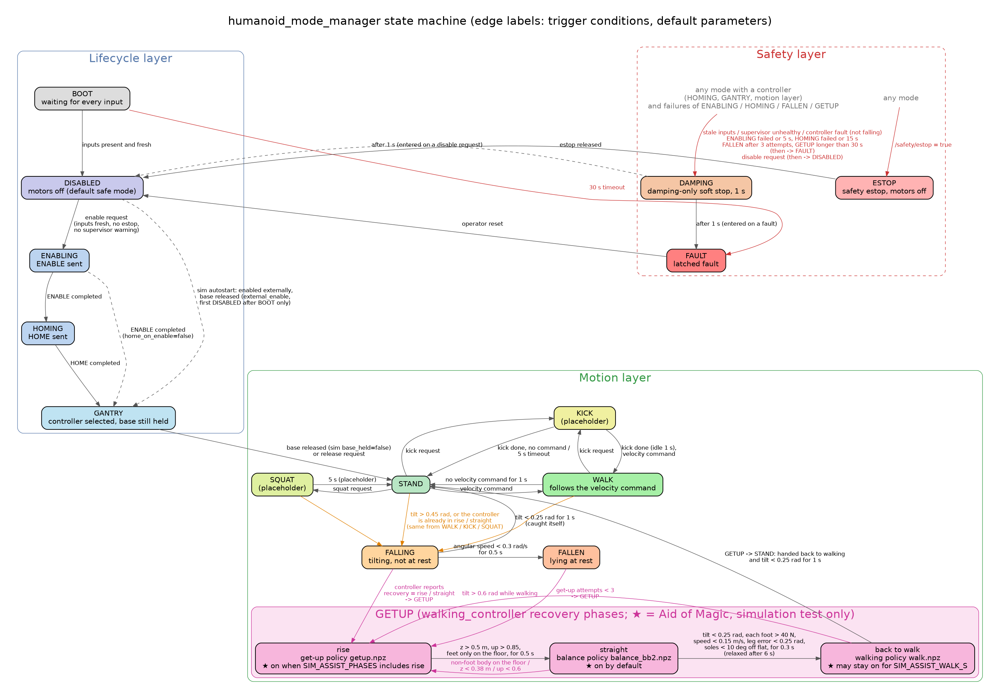

# Humanoid ROS 2 Simulation

MuJoCo simulation of a ten-joint humanoid leg robot running the robot's own
software stack: an ONNX tracking policy or a model-based walking controller
(LIPM MPC + TSID), the C++ command scheduler, safety supervision and Web
monitoring, and a camera ball chase (YOLO on TensorRT or Isaac ROS) with
optional localization from the body IMU and stereo visual odometry.

## Latest goal-shot checkpoint (2026-11-13)

The goal-shot path (tested on the Jetson `vio-test` tree, merged here in
`f15528ca`) has completed autonomous visual approach,
alignment and a kick through the known goal center in simulation. The recorded
success crossed within 1.5 cm of the center; other trials still stopped on command
expiry or failed to score. This is a task-flow baseline for future learned motion,
not a repeatable-stability or physical-robot qualification.

Read the [test report](docs/reports/2026-11-13-goal-shot.md) and
[continuation handoff](docs/handoff-goal-shot-2026-11-13.md) for exact outcomes,
recording locations, unresolved issues and the ML replacement boundary.
The implementation is in this branch (`shoot:=true`, `scene:=shoot`); results
were recorded on the Jetson and have not been re-run here.

## Quick start

ROS 2 Jazzy, or Humble (Jetson / dev container), from the repository root:

```bash
source scripts/setup_rosenv.sh        # first time: Python env, Pinocchio, patched TSID
CMAKE_BUILD_PARALLEL_LEVEL=1 MAKEFLAGS=-j1 colcon build --symlink-install --executor sequential \
  --packages-up-to humanoid_sim humanoid_ball_chase walking_controller humanoid_localization \
  --cmake-args -DTRACK_ONLY=ON      # humanoid_vision: tracker only, no OpenCV detector build
source install/setup.bash
```

Run:

```bash
ros2 launch humanoid_sim sim.launch.py             # policy simulation, viewer, robot held on a gantry
ros2 launch humanoid_sim sim.launch.py auto_start:=true   # enable motors and release when control is ready
scripts/ball_chase_walk.sh scene:=hard             # walking robot chases the football (headless)
```

Jetson extras (see the guides below): `scripts/build_ball_chase_engines.sh` for
the GPU detector, `scripts/run_cuvslam.sh` + `enable_vio:=true` for localization,
`scripts/run_isaac_yolo.sh` + `vision_detector:=isaac` for the Isaac ROS detector.

## Guides

| Topic | README |
|---|---|
| Simulator: launch arguments, viewer, controls, stereo, limitations | [simulation/humanoid_sim](simulation/humanoid_sim/README.md) |
| Ball chase: camera, detectors (TensorRT, Isaac ROS), A*, VIO switch | [simulation/humanoid_ball_chase](simulation/humanoid_ball_chase/README.md) |
| Model-based walking controller | [control/walking_controller](control/walking_controller/README.md) |
| Mode manager (state machine) | [control/humanoid_mode_manager](control/humanoid_mode_manager/README.md) |
| Localization: body IMU + cuVSLAM stereo VO | [perception/humanoid_localization](perception/humanoid_localization/README.md) |
| WBC simulation path (policy + TSID) | [deprecated/wbc_control_node](deprecated/wbc_control_node/README.md) |
| Safety, Web monitoring | [safety/humanoid_safety](safety/humanoid_safety/README.md) |
| Detection and head tracking | [perception/humanoid_vision](perception/humanoid_vision/TRACKING.md) |
| C++ command core | [libraries/control_core](libraries/control_core/README.md) |
| Leg URDF and meshes | [humanoid_leg_description](description/humanoid_leg_description/README.md) |
| Full-body URDF, MoveIt 2 + RViz2 inspection | [humanoid_full_body_moveit_config](description/humanoid_full_body_moveit_config/README.md); simplified vs detailed model: [MODELS.md](description/humanoid_full_body_description/MODELS.md) |
| Evaluations | [VIO and Isaac trials](evaluation/vio_isaac_trials/README.md), [fall predictor](evaluation/fall_predictor/README.md) |
| Documentation index, architecture, build boundaries | [docs](docs/README.md) |
| Physical robot (archived) and legacy code | [hardware](hardware/README.md), [legacy](legacy/README.md) |

## Robot mode state machine

`humanoid_mode_manager` decides the robot mode and which controller owns the motors; the walking
controller's get-up phases are shown with it. Edge labels are the trigger conditions at the default
parameters. It is a placeholder that runs as a dry run (`sim.launch.py mode_manager:=true`); details in
[its README](control/humanoid_mode_manager/README.md) and
[docs/states.md](control/humanoid_mode_manager/docs/states.md).



## Repository layout

Packages are grouped by role. Package names did not change, so `ros2 launch` and
`FindPackageShare` work as before; only repository paths moved.

| Directory | Packages |
|---|---|
| `description/` | `humanoid_leg_description`, `humanoid_full_body_description`, `humanoid_full_body_moveit_config` |
| `control/` | `motor_control_interfaces`, `motor_control_hybrid`, `walking_controller`, `humanoid_mode_manager` |
| `safety/` | `humanoid_safety` |
| `perception/` | `humanoid_vision`, `humanoid_localization` |
| `simulation/` | `humanoid_sim`, `humanoid_ball_chase` |
| `libraries/` | `control_core` (plain CMake, used by `motor_control_hybrid`) |
| `deprecated/` | `wbc_control_node` (still built for `enable_wbc:=true`), `wbc_prototype/` (its isolated model tests) |
| `third_party/tsid/` | TSID 1.7.1 patches applied by `scripts/setup_rosenv.sh` and `scripts/setup_wbc.sh` |
| `hardware/`, `legacy/` | physical-robot sources and historical code, excluded with `COLCON_IGNORE` |
