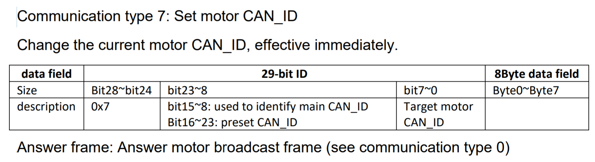
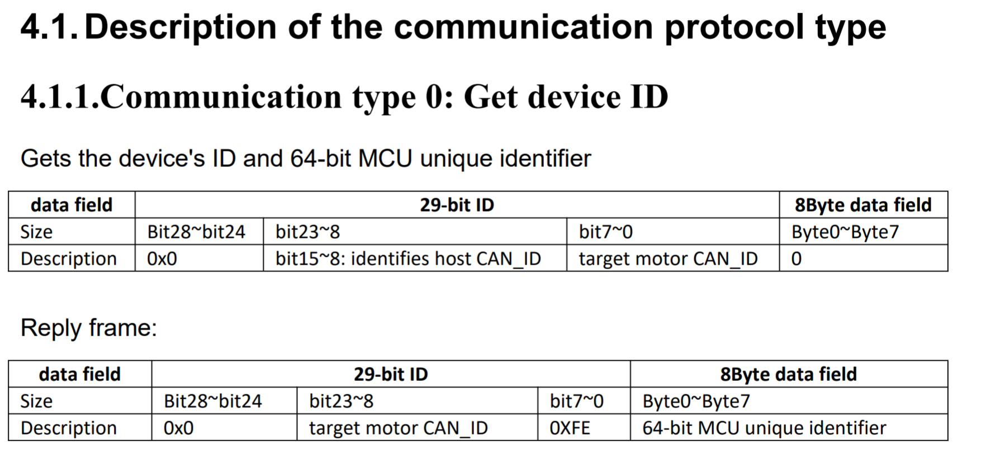

# Triton Droids: RobStride legs, direct-CAN stack

This branch (`robstride_data`) runs the 10-joint legs directly over CAN from Python: system-ID, policy deployment and bring-up tools. It's separate from `main`, which is the ROS 2 humanoid stack.

> **Joint names are mirrored.** Motors 1–5 (`left_*`) are the **physical right** leg, and 6–10 (`right_*`) the physical left leg. Motor 9 is the physical left knee; motor 4 is the physical right knee.

## Safety rules

- **Robot supported** (hanging from the gantry), with **someone holding the E-stop**, before anything enables motors.
- **Battery:** the motors run from a battery that drains even at idle. Charge it before a session, and pass `--vbus-min` to the tools: 35 for 10S Li-ion, 36 for 12S LiFePO4. If every motor goes silent at once, suspect the battery first.
- **Zeros:** check them before every session (below).
  - Run `zero_out.sh` only while every joint is held in the true straight pose. Running it at a bent pose stores that bend as "zero".
- **Never paste terminal output back into a terminal.** Lines containing `>` overwrite files, and a pasted command can move motors.
- **Known issue: the physical right ankle (motor 5) binds** at about 1 Nm since Oct 6. Check it by hand (below) before any walking.

## Layout

```text
setup.sh                       CAN up: finds the CANable by name, 1 Mbit/s, txqueuelen 1000
robot_hardware.py              joint map, motor models, signs, limits (single source)
robstride_dynamics/            RobStride CAN protocol (MIT frames, params, scaling tables)
ctrl_scripts/
  robot_interface.py           connect / enable / read / write / ankle linkage mapping
  run_tracking_policy.py       50 Hz ONNX motion-tracking runner (+ TorqueGuard, ImuSource)
  run_velocity_policy.py       velocity policy from a gamepad
  sysid_logger.py              timestamped hold / one-joint trials, fault bits, VBUS, manifest
  *_config.json, sysid_trials.json
utils/
  sysid_fit.py, sysid_report.py, plot_tracking_log.py   analysis
  motor_health_gui.py, gain_tuner.py                     bring-up and tuning (enable motors)
  imu_read.py, imu_noise_est.py, imu_read/imu_read.ino   IMU reader, bias/noise check, board firmware
  validation_code/             id_check, check_can_liveness, joint_direction_monitor,
                               motor_param_diff, motor_drag_test
docs/                          step-by-step guides (start with no_movement_motor_test_guide.md)
results/system_id/             fitted actuator parameters (raw logs stay in logs/, not in git)
```

## One-time setup

```bash
sudo apt-get install can-utils python3-venv
python3 -m venv .venv && .venv/bin/pip install -r requirements.txt
```

## Every session

1. **Battery charged, robot on the gantry, E-stop in hand.**
2. **CAN up.** This works with the IMU plugged in, because the CANable is found by name:
   ```bash
   ./setup.sh                     # or ./setup.sh /dev/ttyACM2 to name the adapter
   ```
   - **Expect:** `state UP`, `ERROR-ACTIVE` and `qlen 1000`.
   - Run it again after every boot or replug.
3. **All motors answer, with nothing enabled:**
   ```bash
   python3 utils/validation_code/id_check.py --channel can0 --bitrate 1000000 --start 1 --end 10
   ```
4. **Zeros:** hang the legs straight, then run:
   ```bash
   ./.venv/bin/python utils/validation_code/joint_direction_monitor.py --seconds 5
   ```
   Every joint should read within ±1°, and the knees 0° or slightly negative, never positive.
5. **Preflight**, which never enables or transmits. It prints the config, file hashes, CAN state and IMU gravity (about `(0, 0, -1)` when hanging):
   ```bash
   ./.venv/bin/python ctrl_scripts/sysid_logger.py --check
   ```

To watch the bus at any time: `candump -x -t a can0`.

## Workflow

1. **Hold** (energises all motors and holds the pose):
   ```bash
   ./.venv/bin/python ctrl_scripts/sysid_logger.py --hold --seconds 10 --session logs/system_id/<name> --vbus-min 35
   ```
2. **One-joint trials:** run `sysid_logger.py --list`, then `--trial <name> --yes --session ... --vbus-min 35`. Check each with `./.venv/bin/python utils/sysid_report.py <session>`.
3. **Fit**, on CPU in a separate venv; see `results/system_id/*/README.md`:
   ```bash
   ~/Documents/simulation/.venv-sysid/bin/python utils/sysid_fit.py <session> --base yaw --out fit
   ```
4. **Train** the velocity policy on the GPU machine: `cad/train_velocity.py --fit sysid_params.json` in the simulation repo.
5. **Check, then run it.** Details are in `docs/velocity_policy_deployment.md`.
   ```bash
   ./.venv/bin/python ctrl_scripts/run_velocity_policy.py --policy <run>/<run>.onnx --check          # no CAN
   ./.venv/bin/python ctrl_scripts/run_velocity_policy.py --policy <run>/<run>.onnx --yes --vbus-min 35
   ```
   On the gamepad: hold the deadman and press **A** to home to the stand pose; hold the deadman and press **Start** to run the policy; **B** stops. Releasing the deadman makes it stand still.

## Maintenance checks

- **Right-ankle binding (motor 5):** with the motors off, move both feet up and down by hand and compare them. Feel for a tight or gritty spot, and check the linkage rods, joints and screws.
- **IMU gyro bias.** Do this after reflashing or replacing the IMU board, with the robot completely still:
  ```bash
  ./.venv/bin/python utils/imu_noise_est.py --source serial \
      --port /dev/serial/by-id/usb-1a86_USB_Single_Serial_5AE8012534-if00 --duration 60
  ```
  Copy the mean `gyro_dps` (sensor frame, deg/s) into `imu.gyro_bias_dps` in `ctrl_scripts/run_tracking_config.json`.
- **IMU mount:** on the pelvis near the centre, sensor +X toward the robot's front, +Y to its left, +Z up. Screwed rigid and level within 2°. Use the CH343 USB port (`1a86:55d3`).
- **A new or replaced motor:**
  1. Find its ID: `000001XX` scan, see below.
  2. Set it with `07`, then power-cycle.
  3. Compare its parameters: `utils/validation_code/motor_param_diff.py --motors 4,9 --all`.
  4. Check direction: `joint_direction_monitor.py --joint <id>`.

## Troubleshooting

| Symptom | Likely cause |
|---|---|
| `setup.sh`: no CANable found | The adapter isn't plugged in. Check `ls -l /dev/serial/by-id/`. |
| `id_check` gets no replies, `ip -s link` shows TX rising and RX flat | No motor power: battery flat or the protection board cut out, the E-stop, or the harness. |
| All motors go silent at once mid-run, last torques 0 Nm | A battery or protection-board cutout. Charge it, and check VBUS in the logs. |
| Safety trip "out of limits" on a knee at startup | The zero is off, so the knee reads positive. Re-check zeros (step 4). |
| An occasional single dropped frame | Queue too short. Re-run `./setup.sh`, which sets `txqueuelen 1000`. |
| IMU gravity not about (0, 0, −1) when hanging | The board is mounted differently. Check `imu.axis_map` in the config. |

## Motor CAN commands (`cansend` reference)

Frame IDs are `TT DDDD II`: type, data, then motor ID. `FE` is the host ID.

| What | Command |
|---|---|
| Ping motor 1 | `cansend can0 0000FE01#0000000000000000` (type 0, get device ID; never enables) |
| Scan IDs 0–12 | `for i in {0..12}; do cansend can0 $(printf "000001%02X#0000000000000000" $i); sleep 0.02; done` |
| Set CAN ID 0x7F → 0x05 | `cansend can0 0705FE7F#0000000000000000` (then power-cycle) |
| Stop / disable motor 1 | `cansend can0 0400FE01#0100000000000000` |
| Set zero, motor 1 | `cansend can0 0600FE01#0100000000000000` (hold the joint straight) |

`0300FE..` (type 3) **enables** a motor. Use it only on purpose, with the robot supported.



