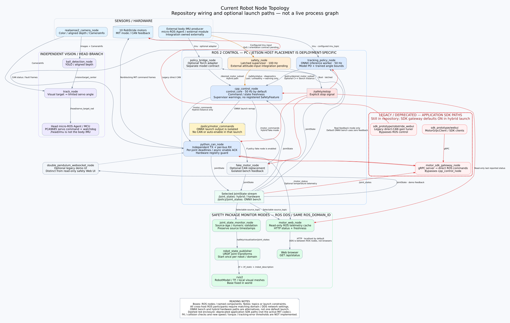
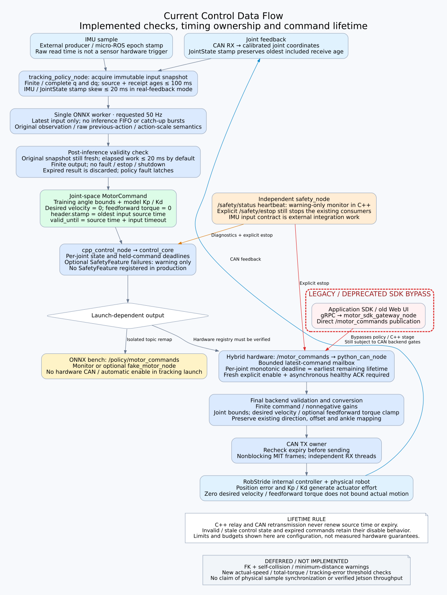

# Humanoid ROS 2 Control Stack

ROS 2 workspace for humanoid leg policy inference, RobStride CAN communication,
safety supervision, telemetry, and single-axis visual head tracking. Robot
descriptions are provided for display; retained MoveIt and serial IMU sources
are documented under [Legacy](#legacy).

The current leg policy produces joint-position targets at 50 Hz. The C++
control node schedules commands and checks their execution conditions; the
Python CAN node communicates with the motors. Head tracking is a separate
camera-to-servo path.

## Contents

- [Workspace layout](#workspace-layout)
- [Architecture](#architecture)
  - [Node topology](#node-topology)
  - [Control data flow](#control-data-flow)
- [Nodes and ROS interfaces](#nodes-and-ros-interfaces)
  - [Control and policy nodes](#control-and-policy-nodes)
  - [Safety and monitoring nodes](#safety-and-monitoring-nodes)
  - [Vision, IMU, and MCU nodes](#vision-imu-and-mcu-nodes)
- [External nodes used by active launch files](#external-nodes-used-by-active-launch-files)
- [Published targets and commands](#published-targets-and-commands)
- [Tracking model inputs and outputs](#tracking-model-inputs-and-outputs)
  - [Input tensors](#input-tensors)
  - [Output and decoding parameters](#output-and-decoding-parameters)
  - [Runtime input and timing parameters](#runtime-input-and-timing-parameters)
- [MotorCommand contract](#motorcommand-contract)
- [Published feedback and diagnostics](#published-feedback-and-diagnostics)
- [Setup and build](#setup-and-build)
- [Launch entry points](#launch-entry-points)
- [Detailed guides](#detailed-guides)
- [Legacy](#legacy)
  - [Packages](#packages)
  - [Nodes and adapters](#nodes-and-adapters)
  - [External nodes in legacy launches](#external-nodes-in-legacy-launches)

## Workspace layout

| Path | Purpose |
|---|---|
| [`humanoid_control/motor_control_interfaces`](humanoid_control/motor_control_interfaces) | Shared `MotorCommand` message definition. |
| [`humanoid_control/motor_control_hybrid`](humanoid_control/motor_control_hybrid) | ONNX policy, C++ command scheduler, CAN transport, and fake motors. |
| [`Interfaces/control_core`](Interfaces/control_core) | ROS-independent per-joint command selection and hold-last storage used by the scheduler. |
| [`humanoid_control/humanoid_safety`](humanoid_control/humanoid_safety) | Latched safety supervisor, read-only Web/ROS monitoring, and advisory self-collision checks. |
| [`simulation/humanoid_sim`](simulation/humanoid_sim) | MuJoCo simulation with a minimal direct policy loop; optional full-stack integration replaces CAN, IMU/head MCUs and camera. |
| [`humanoid_vision`](humanoid_vision) | Detection, optional depth projection, image viewing, and host-side head tracking. |
| [`imu_process`](imu_process) | Body/head MCU firmware, serial IMU package, fusion utilities, fall detector, and acceptance probe. |
| [`humanoid_leg_description`](humanoid_leg_description), [`humanoid_arm_description`](humanoid_arm_description) | URDFs, meshes, and display launch files. |
| [`launch`](launch) | Workspace-level system, head-tracking, and display entry points. |
| [`legacy`](legacy) | Retained arm/leg MoveIt packages and application SDK prototype/examples. |

## Architecture

These existing diagrams show repository wiring and optional launch paths, not
a live process graph. The node and interface tables below describe the current
implementation and distinguish active components from legacy sources.

### Node topology



[Open SVG](docs/architecture/node_topology.svg) ·
[Graphviz source](docs/architecture/node_topology.dot)

### Control data flow



[Open SVG](docs/architecture/control_data_flow.svg) ·
[Graphviz source](docs/architecture/control_data_flow.dot)

The policy launch does not start CAN or send motor-enable commands. The unified
system launch starts control, safety, vision, and display, but does not start the
ONNX policy. These launch paths require deliberate composition for hardware
policy execution. They are not connected automatically.

## Nodes and ROS interfaces

The tables list application topics from the repository sources. Standard ROS
logging, parameter services, and `/parameter_events` are omitted. Topics shown
with a leading `/` are the names used at the root namespace. CAN, fake-motor,
SDK, and WebSocket nodes use relative motor topic names, so a namespace changes
those names. Parameter overrides and launch remappings can change the defaults.

Message abbreviations below: `MotorCommand` =
`motor_control_interfaces/msg/MotorCommand`, `JointState` =
`sensor_msgs/msg/JointState`, `Imu` = `sensor_msgs/msg/Imu`, `PointStamped` =
`geometry_msgs/msg/PointStamped`, and `DiagnosticArray` =
`diagnostic_msgs/msg/DiagnosticArray`.

### Control and policy nodes

| Node | Responsibility | Publishes | Subscribes |
|---|---|---|---|
| [`tracking_policy_node`](humanoid_control/motor_control_hybrid/motor_control_hybrid/tracking_policy_node.py) | Runs the ten-joint ONNX policy at 50 Hz; calibrates the gyro and checks input freshness, input skew, inference deadlines, and estop. | `/policy/actions`, `/policy/target_angles`, `/policy/desired_motor_subset`, `/policy/status` | Configurable IMU and joint-state inputs; `/safety/estop` |
| [`cpp_control_node`](humanoid_control/motor_control_hybrid/src/cpp_control_node.cpp) | Schedules per-joint commands at 50 Hz. Enforces deadlines/estop and hosts the default-disabled zero stop/wait state machine with async backend clients. | `/motor_commands`, `/control_core/abstract_command_status` | `/joint_states`, `/desired_motor_subset`, `/desired_velocity_subset`, `/control_core/abstract_command`, `/safety/estop`, `/safety/status` |
| [`python_can_node`](humanoid_control/motor_control_hybrid/motor_control_hybrid/python_can_node.py) | Owns RobStride CAN I/O with independent TX and per-interface RX threads. Checks commands, tracks enable acknowledgements, enforces local deadlines, and publishes feedback. | `/joint_states`, `/motor_status`, `/motor_telemetry`, `/can_timing` | `/motor_commands`, `/safety/estop` |
| [`fake_motor_node`](humanoid_control/motor_control_hybrid/motor_control_hybrid/fake_motor_node.py) | Provides simple simulated joint motion and status without CAN hardware. It is a testing backend, not a dynamics-equivalent motor model. | `/joint_states`, `/motor_status` | `/motor_commands`, `/safety/estop` |

The real CAN node also serves `/motor_backend/get_feedback`
(`motor_control_interfaces/srv/GetMotorFeedback`) for cached raw motor-coordinate
feedback, and `/motor_backend/execute_operation`
(`motor_control_interfaces/srv/ExecuteMotorOperation`) as a management admission
endpoint. Set Zero requests are currently rejected as not ready; no service
sends a calibration frame. Home admission and trajectory generation remain
unimplemented in control_core. See the
[backend service contract](docs/robstride_abstract_command_design.md#initial-backend-services).
Both service names are relative in code and follow the node namespace.
The C++ adapter also serves `/control_core/submit_abstract_command` for the same
admission path as its abstract-command topic. Zero processing is disabled by
default; backend acceptance alone cannot complete calibration or resume control.

The policy node's standalone joint-state default is `/joint_states`; the
tracking launch selects `/policy/joint_states`. Its default
`joint_feedback_mode:=zero` supplies zero joint feedback internally. Select
`joint_feedback_mode:=joint_states` to require actual JointState inputs.

Ordinary C++ command forwarding does not run inference, calculate PD torque or
perform inverse dynamics. The separate zero transaction can generate bounded
deceleration targets when explicitly commissioned. Its normal control core updates commanded
joints and holds the previous commands for other joints, subject to command
expiry. Missing/stale feedback from any configured joint, an expired tracked
command, or an asserted estop causes all configured joints to be disabled and
cached commands to be cleared. Default feedback and command timeouts are
0.2 s and 0.5 s. A missing or unhealthy `/safety/status` heartbeat produces a
warning; it does not independently trip the estop. No `SafetyFeature` plugin is
currently registered in the production scheduler.

### Safety and monitoring nodes

| Node | Responsibility | Publishes | Subscribes |
|---|---|---|---|
| [`safety_node`](humanoid_control/humanoid_safety/humanoid_safety/safety_node.py) | Checks IMU orientation and source/receipt freshness on a steady-clock timer; latches estop on a confirmed fall or IMU timeout. Provides `/safety/reset` (`std_srvs/srv/Trigger`). | `/safety/estop`, `/safety/status` | `/imu/data_raw` |
| [`motor_web_node`](humanoid_control/humanoid_safety/humanoid_safety/motor_web_node.py) | Serves read-only motor telemetry over HTTP, default `127.0.0.1:8080`. Tracks state age, temperature, estop, and supervisor health. | No application topics | `/joint_states`, `/motor_telemetry`, `/safety/estop`, `/safety/status` |
| [`joint_state_monitor_node`](humanoid_control/humanoid_safety/humanoid_safety/joint_state_monitor_node.py) | Validates and relays JointState messages while preserving source timestamps. | Configurable `output_topic` | Configurable `source_topic` |
| [`self_collision_monitor_node`](humanoid_control/humanoid_safety/humanoid_safety/self_collision/monitor_node.py) | Checks measured poses, target poses, and a sampled path between them; publishes advisory distances/collisions at 20 Hz by default. | `/safety/self_collision`, optional `/safety/self_collision/markers` | `/joint_states`, `/policy/target_angles` |

The relay's standalone defaults are `/policy/joint_states` to `/joint_states`.
The safety launch instead defaults to `/joint_states` to
`/safety/visualization/joint_states`. The
[`motor_control_hybrid` relay entry](humanoid_control/motor_control_hybrid/motor_control_hybrid/joint_state_monitor_node.py)
is a compatibility alias for this same implementation, not another processing
stage. `benchmark_self_collision` is a non-ROS CLI helper, not a node.

Self-collision monitoring requires its selected geometry backend and is
warning-only: it does not publish motor commands or estop. Resetting the safety
latch does not itself enable motors.

### Vision, IMU, and MCU nodes

| Node | Responsibility | Publishes | Subscribes |
|---|---|---|---|
| [`ball_detection_node`](humanoid_vision/src/ball_detection_node.cpp) | Runs YOLO, selects the highest-confidence detection, and publishes its pixel center plus an optional depth-derived 3D point. The bundled model detects faces. | `/vision/target_center`, `/vision/ball_3d_position` | `/camera/camera/color/image_raw`, `/camera/camera/aligned_depth_to_color/image_raw`, `/camera/camera/color/camera_info` |
| [`track_node`](humanoid_vision/src/track_node.cpp) | Converts pixel-center error and camera intrinsics into a single yaw or pitch angle command. Applies deadband, speed/acceleration limits, angle limits, and freshness checks. | `/head/servo_target_rad` | `/vision/target_center`, `/camera/camera/color/camera_info` |
| [`image_viewer_node`](humanoid_vision/src/image_viewer_node.cpp) | Displays cached color and aligned-depth images for camera diagnostics. | No application topics | Configurable color/depth topics, defaulting to the camera image topics above |
| [`body_imu_mcu`](imu_process/policy_imu/policy_imu_microros/policy_imu_microros.ino) | Body BNO085 micro-ROS firmware; publishes IMU samples on a 10 ms timer and status on a 1 s timer. | `/imu/data_raw`, `/imu/status` | No application topics |
| [`head_mcu`](imu_process/head_mcu/humanoid_vision_microros/humanoid_vision_microros.ino) | Head micro-ROS firmware; publishes raw IMU telemetry and maps servo angles to PCA9685 channel 8 PWM. Releases PWM on command timeout. | `/head/imu`, `/head/mcu_status` | `/head/servo_target_rad` |
| [`body_imu_probe`](imu_process/policy_imu/policy_imu_microros/check_body_imu.py) | Read-only acceptance helper for IMU timing, units, orientation validity, and optional stationary/upright checks. | No application topics | Configurable IMU topic, default `/imu/data_raw`; `/imu/status` |

The body MCU is the current body IMU producer. The retained serial reader is
documented under [Legacy](#legacy). The head IMU reports no fused orientation and is not
a substitute for the body IMU. The head branch does not consume the body's
`/safety/estop`; it has its own command-loss watchdog.

## External nodes used by active launch files

These nodes come from ROS packages rather than implementations in this repository.
Their complete interfaces depend on the installed version and loaded plugins.

| Node/process | Role and relevant interfaces |
|---|---|
| `realsense2_camera_node` | Publishes color images and CameraInfo; publishes aligned depth when enabled. Head launch uses namespace/name `camera/camera`. |
| `micro_ros_agent` | Connects MCU micro-ROS entities to DDS over the configured transport. Head launch defaults to a native Agent; Docker mode is optional. |
| `robot_state_publisher` | Consumes selected joint states and publishes `/tf`, `/tf_static`, and `/robot_description` for the chosen URDF. |
| `joint_state_publisher_gui` | Generates manual `/joint_states` for display/testing; these are not hardware measurements. |
| `rviz2` | Displays robot transforms, models, and configured diagnostics/markers. |

Temporary nodes created inside tests are test fixtures, not additional runtime
components. The arm description display entry currently forwards to the shared
leg display; the arm MoveIt demo uses the arm model.

## Published targets and commands

Targets describe requested behavior. Feedback describes measured or simulated
state. A topic named `JointState` can carry either, so its topic and producer
matter.

| Topic and type | Producer -> consumer | Meaning and purpose |
|---|---|---|
| `/policy/actions` — `std_msgs/msg/Float64MultiArray` | ONNX policy -> inspection/logging | Ten raw policy actions in model joint order. These are action values, not angles, velocities, or torques; the runtime does not clamp them to `[-1, 1]`. |
| `/policy/target_angles` — `JointState` | ONNX policy -> collision monitor, optional visualization | Ten decoded and limited joint-position targets in `position`, in radians. They are commanded poses, not measured feedback. |
| `/policy/desired_motor_subset` — `MotorCommand` | ONNX policy -> optional remapped C++ scheduler | Executable policy target envelope: MIT motion mode, decoded angles, zero desired velocity, zero feedforward torque, model PD gains, source timestamp, and expiry. It remains isolated from hardware by default. |
| `/desired_motor_subset` — `MotorCommand` | Upstream controller or Torch adapter -> C++ scheduler | Requested commands for named joints. Can carry mode, position, velocity, acceleration, feedforward torque, and gains. This is the scheduler's normal unremapped input. |
| `/desired_velocity_subset` — `JointState` | External producer -> C++ scheduler | Compatibility input using `name` and `velocity` (rad/s) to request per-joint velocity commands. The repository does not launch a dedicated producer. |
| `/motor_commands` — `MotorCommand` | C++ scheduler or direct adapter -> real/fake motor backend | Commands actually submitted to the backend, including enable/disable. The real backend validates them and converts them into CAN frames. |
| `/policy/motor_commands` — `MotorCommand` | Optional remapped C++ scheduler -> namespaced fake backend | Bench counterpart of `/motor_commands`; the tracking launch does not route it to real CAN or automatically enable fake motors. |
| `/vision/target_center` — `PointStamped` | Detector -> head tracker | `x=u`, `y=v` in color-image pixels, `z=0`, with the original color-image header. It identifies where to center the camera, not a 3D position. No message is sent when no target is detected. |
| `/vision/ball_3d_position` — `PointStamped` | Detector -> external consumers | Optional target center in camera optical coordinates, in meters. Despite the topic name, the bundled detector currently detects faces. No repository controller currently subscribes to this output. |
| `/head/servo_target_rad` — `std_msgs/msg/Float32` | Head tracker -> head MCU | Absolute single-axis servo angle command in radians, mapped to PWM on channel 8. It is a command estimate, not encoder feedback. |

All topic names in this table are defaults or the explicit tracking-launch
remappings. The detector's 2D center does not require depth. Its 3D path uses
cached aligned depth and CameraInfo without timestamp synchronization; 3D output
must not be treated as a synchronized body/world position. The tracker uses only
the pixel center and CameraInfo, not the 3D point or head IMU.

## Tracking model inputs and outputs

The deployed tracking export is
[`20260914_170827.onnx`](humanoid_control/motor_control_hybrid/models/20260914_170827/20260914_170827.onnx):
56 observation values, ten actions, and a 50 Hz policy period. The runtime uses
CPU ONNX Runtime. This contract belongs to the tracking export; the retained
Torch bridge and vision detector have separate input/output contracts.

### Input tensors

| ONNX input | Type and shape | Meaning |
|---|---|---|
| `obs` | `float32 [1, 56]` | One observation assembled in the exact order below. |
| `time_step` | `float32 [1, 1]` | Integer-valued reference-frame index, passed as `[[frame]]`; not elapsed seconds or the integration step. |

Observation slices use zero-based, end-exclusive indexing:

| Slice in `obs[0]` | Size | Parameter | Source and units |
|---|---:|---|---|
| `[0:10]` | 10 | `q_reference` | Joint angles from the current embedded reference frame, rad. |
| `[10:20]` | 10 | `dq_reference` | Joint velocities from the same reference frame, rad/s. |
| `[20:23]` | 3 | `base_ang_vel` | Body-frame IMU angular velocity after mounting rotation and gyro-bias subtraction, rad/s. |
| `[23:33]` | 10 | `joint_pos` | Current joint positions minus `q_default`, rad. |
| `[33:43]` | 10 | `joint_vel` | Current joint velocities, rad/s. |
| `[43:53]` | 10 | `previous_actions` | Last accepted raw policy actions, dimensionless; initially zero. These are not the clipped target angles. |
| `[53:56]` | 3 | `gravity` | Unit world-down vector expressed in body coordinates, dimensionless; upright is `[0, 0, -1]`. |

The first 20 values form the model's `command` observation: a reference motion
to follow, not a joystick speed command. The export contains 299 reference
frames. The runtime selects `min(int(elapsed_seconds * 50), 298)` after policy
execution begins and holds the final reference frame instead of looping.
Reference velocities in `obs` describe that motion; they are not copied into
the published motor target velocity.

All ten-joint input and output vectors follow this exact order. Incoming
JointState messages are reordered by name, not assumed to arrive in this order:

```text
left_hip1_joint, left_hip2_joint, left_thigh_joint, left_knee_joint,
left_ankle_joint, right_hip1_joint, right_hip2_joint, right_thigh_joint,
right_knee_joint, right_ankle_joint
```

With `joint_feedback_mode:=joint_states`, positions and velocities must be
complete and finite for all ten joints. With the default `zero` mode, both
position is set to `q_default` and velocity to zero regardless of received
feedback, so the centered position observation is zero. This is a bench
setting, not measured robot state. IMU linear acceleration is used to estimate gravity
but is not a separate raw acceleration input in the 56-element observation.

### Output and decoding parameters

The runtime requests the ONNX output named `actions`, expects one batch of ten
finite values, and removes the batch dimension to obtain a `(10,)` vector.
These values are dimensionless position actions, not physical angles or torque.
The runtime does not request any auxiliary outputs from the export.

| Parameter | Current value/source | Effect |
|---|---|---|
| `q_default` | Model metadata `default_joint_pos`; ten zeros | Joint offsets for both observation centering and target decoding, rad. |
| `action_scale` | Model metadata; `0.2` for every joint | Converts each action into a position offset in radians. |
| `joint_lower`, `joint_upper` | Joint ranges in the saved `chrobot_16kg_candidate.xml` beside the model | Limits decoded targets; independent of raw action magnitude. |
| `Kp`, `Kd` | Model metadata `joint_stiffness`, `joint_damping` | Fixed execution gains copied into every policy MotorCommand; not predicted outputs. |

```text
q_target = clip(q_default + action_scale * action, joint_lower, joint_upper)
```

Current model metadata specifies zero default positions and an action scale of
0.2 for all ten joints. For example, action `1.5` becomes `0.3 rad` before joint
limits are applied. The runtime publishes target velocity and feedforward torque
as zero, and copies fixed gains from the model metadata:

| Joint, on each side | Kp | Kd |
|---|---:|---:|
| Hip1, hip2, thigh | 100 | 1 |
| Knee | 80 | 1 |
| Ankle | 20 | 1 |

The policy predicts actions, not gains or torque. These are the deployed model's
settings, not evidence of physical actuator calibration. See
[`tracking_onnx.py`](humanoid_control/motor_control_hybrid/motor_control_hybrid/tracking_onnx.py)
and the [motor registry](humanoid_control/motor_control_hybrid/config/motors.yaml).

For MIT motion mode, the intended actuator relation is:

\[\tau = K_p \cdot (q_{target} - q) + K_d \cdot (\dot{q}_{target} - \dot{q}) + \tau_{ff}\]

The current node sets `dq_target = 0`, `tau_ff = 0`, and the message's
acceleration field to zero. Motor feedback supplies `q` and `dq` for actuator
execution. The C++ scheduler forwards the gains/targets rather than evaluating
this PD equation. Dynamic desired velocity or feedforward torque is not a model
output in the current deployment and would change its execution behavior.

### Runtime input and timing parameters

These are ROS node parameters, not additional ONNX input tensors:

| Parameter | Default | Meaning |
|---|---|---|
| `model_path` | Installed `models/20260914_170827/20260914_170827.onnx` | Export to load; the tracking launch also validates it against the motor registry. |
| `control_rate_hz` | `50.0` | Required policy rate; this export rejects other configured rates. |
| `imu_topic` | `/imu/data_raw` | Body IMU source. |
| `imu_frame` | `imu_link` | Required incoming IMU frame ID. |
| `imu_to_body_rotation` | Identity 3x3 matrix, row-major | Proper rotation mapping sensor acceleration/gyro into body coordinates; identity assumes aligned mounting. |
| `orientation_source` | `message` | Uses the IMU quaternion for gravity; gyro remains a separate input. `complementary` is an explicit legacy raw-IMU option. |
| `hold_first_frame` | `false` | Freeze the reference index at 0 while continuing feedback and policy inference for a balance experiment. |
| `calibration_seconds` | `2.0` | Stationary startup sampling to estimate gyro bias. |
| `joint_states_topic` | `/joint_states` standalone; `/policy/joint_states` in tracking launch | Joint feedback source when real feedback mode is selected. |
| `joint_feedback_mode` | `zero` | `zero` for bench inputs or `joint_states` for validated position/velocity feedback. |
| `input_timeout_s` | `0.1` | Maximum source and receipt age of inputs. |
| `max_input_skew_s` | `0.02` | Maximum IMU/joint-state source-time difference when joint feedback is used. |
| `max_inference_s` | `0.02` | Maximum snapshot-to-result processing time, including inference. |

Stale inputs, invalid data, expired inference results, or estop latch a policy
fault and stop target publication. Restart the policy node after resolving the
fault; clearing estop alone does not reset its fault. Published command timing
comes from the oldest selected input, with expiry at that source time plus
`input_timeout_s`, rather than from inference completion time.

## MotorCommand contract

The authoritative definition is
[`MotorCommand.msg`](humanoid_control/motor_control_interfaces/msg/MotorCommand.msg).
`joint_name[i]` identifies the joint for the corresponding field entries;
`mode` can contain one broadcast value or one value per joint. Modes are velocity
(`0`), position (`1`), MIT motion (`2`), enable (`3`), and disable (`4`). Position
and velocity are in radians and radians/second; feedforward torque is in Nm at
the joint-command interface, with hardware mapping handled by the backend.
Velocity fields have mode-dependent meaning; they are not always trajectory
velocity references. Acceleration is carried in the message but the C++
scheduler does not generate an acceleration-limited trajectory from it.

`header.stamp` preserves the originating command/observation time;
`valid_until` supplies an absolute ROS deadline. Zero expiry falls back to the
source-stamp watchdog. Forwarding must not renew an old command's lifetime.
Disable requests remain admissible even when their timestamps are invalid.

## Published feedback and diagnostics

| Topic and type | Producer | Purpose |
|---|---|---|
| `/joint_states` — `JointState` | CAN or fake backend | Joint position, velocity, and effort for the scheduler and visualization. Simulated feedback is not physical measurement. |
| `/policy/joint_states` — `JointState` | Namespaced fake backend or selected external source | Feedback for the isolated policy bench. |
| `/safety/visualization/joint_states` — `JointState` | Safety relay in default monitoring launch | Validated display stream preserving source timestamps. Its content depends on the selected source. |
| `/motor_status` — `std_msgs/msg/String` | CAN or fake backend | JSON indexed motor temperatures and torque for retained adapter clients. |
| `/motor_telemetry` — `std_msgs/msg/String` | CAN backend | Versioned JSON with joint/bus/motor identity, source time, and temperature for the read-only Web monitor. |
| `/can_timing` — `std_msgs/msg/String` | CAN backend | Transport timing/counter JSON for diagnosing CAN scheduling and errors. |
| `/policy/status` — `std_msgs/msg/String` | ONNX policy | Policy state, faults, input rejection, and timing metrics. |
| `/imu/data_raw` — `Imu` | Body MCU or serial reader | Body angular velocity (rad/s), acceleration (m/s^2), and available orientation for policy/safety. |
| `/imu/status` — `std_msgs/msg/String` | Body MCU | JSON sensor, timing, and connection diagnostics. |
| `/head/imu` — `Imu` | Head MCU | Raw head acceleration and angular velocity; orientation is unavailable. |
| `/head/mcu_status` — `std_msgs/msg/Int32` | Head MCU | Bit flags for IMU, PCA9685, servo-enabled, and clock-sync state. |
| `/odom` — `nav_msgs/msg/Odometry` | Optional serial reader integration | IMU dead-reckoned odometry; not an independently measured robot position. |
| `/safety/estop` — `std_msgs/msg/Bool` | Safety supervisor | Reliable, transient-local emergency-stop state. `true` requests motor disable; a reset does not issue enable commands. |
| `/safety/status` — `DiagnosticArray` | Safety supervisor | Check health, latch state, and reason. |
| `/safety/self_collision` — `DiagnosticArray` | Collision monitor | Measured/target/path clearance or collision reports; advisory only. |
| `/safety/self_collision/markers` — `visualization_msgs/msg/MarkerArray` | Collision monitor when enabled | RViz shapes highlighting the selected check's closest/colliding links. |

## Setup and build

Use the ROS distribution matching the host OS. The setup examples below target
ROS 2 Jazzy on Ubuntu 24.04 / Python 3.12. Recreate `rosenv/` on each host; do not
copy it across Python or ROS distributions.

On other Linux distributions, or to avoid a native ROS install, use the Humble
[dev container](docs/devcontainer.md).

Install the shared control, ONNX, MuJoCo and test dependencies into `rosenv`:

```bash
ROS_DISTRO=jazzy source scripts/setup_rosenv.sh
```

The installer uses [`requirements-rosenv.txt`](requirements-rosenv.txt), checks
the Python version against the host ROS interpreter, and refreshes dependencies
when any included requirements file changes. `ROSENV_FORCE_INSTALL=1` forces a
dependency check. Only a successful install updates the cache. The default ONNX
policy does not need PyTorch; use `INSTALL_TORCH=1 source scripts/setup_rosenv.sh`
to add CPU PyTorch for the legacy policy bridge.

In every new terminal, load ROS, the virtualenv and the built workspace together:

```bash
source scripts/activate_rosenv.sh
```

Setup also adds a managed hook to `rosenv/bin/activate` so ROS executables using
system Python can find the virtualenv packages. The package path is determined
from the interpreter, without hardcoding Python 3.10 or 3.12.

To install the same environment and build the selected control, safety and
serial IMU packages:

```bash
ROS_DISTRO=jazzy bash scripts/setup_tracking_policy.sh
source scripts/activate_rosenv.sh
```

C++/ROS dependencies (including OpenCV, camera drivers and micro-ROS Agent)
remain system dependencies installed through ROS/rosdep, not pip packages in
`rosenv`. See the [simulation setup](simulation/humanoid_sim/README.md#setup)
for building and starting MuJoCo.

### ENCOS backend dependency

`motor_control_hybrid` builds `encos_can_node` by default. CMake first searches
for an installed `encos_driver >= 4.0`; if none is found, it downloads official
revision `5ae8c3a92f6387369b674bfe7563bc053a460075` (4.0.0) into the build
directory. The downloaded driver includes only the CAN adapter and is linked
statically into the node, so no separate ENCOS shared library or CAN plugin
installation is required. The first configuration needs Git and network access;
subsequent builds reuse the downloaded source.

Install the system development dependencies through rosdep or, on Ubuntu:

```bash
sudo apt install libyaml-cpp-dev libspdlog-dev libfmt-dev libzstd-dev libcap-dev
```

CMake downloads the driver source; it does not install OS packages. For an
offline build, point `-DFETCHCONTENT_SOURCE_DIR_ENCOS_DRIVER=/absolute/path/to/encos_driver`
at a local checkout of the pinned revision, or provide an installed package
through `-Dencos_driver_DIR=/prefix/lib/cmake/encos_driver`. Set
`-DMOTOR_CONTROL_FETCH_ENCOS=OFF` to prohibit downloads (a missing driver then
fails configuration), or `-DMOTOR_CONTROL_BUILD_ENCOS=OFF` to omit this backend.
Pass these options after `colcon build --cmake-args`.

#### Updating to the latest upstream source

The default download is pinned; it does not automatically follow upstream
updates. To try the latest commit on the official repository's default branch,
clone it separately and override the FetchContent source directory:

```bash
mkdir -p "$HOME/src"
git clone https://github.com/EncosTech/encos_driver.git "$HOME/src/encos_driver"
git -C "$HOME/src/encos_driver" rev-parse HEAD
CMAKE_BUILD_PARALLEL_LEVEL=1 MAKEFLAGS=-j1 colcon build \
  --packages-select motor_control_interfaces motor_control_hybrid \
  --executor sequential --cmake-args \
  -DCMAKE_DISABLE_FIND_PACKAGE_encos_driver=TRUE \
  -DFETCHCONTENT_SOURCE_DIR_ENCOS_DRIVER="$HOME/src/encos_driver"
```

For subsequent updates, run `git -C "$HOME/src/encos_driver" pull --ff-only`
and repeat the build. Disabling package discovery ensures an installed driver
does not take precedence over this checkout. This selects the latest development
source, which may differ from the latest release and has not been validated by
this repository. After reviewing and testing an update, replace `GIT_TAG` in
`humanoid_control/motor_control_hybrid/cmake/EncosDriver.cmake` with the full
tested commit hash and update the documented version. Remove the local override
with `--cmake-clean-cache` when returning to the default pinned build.

Building does not access CAN, grant capabilities, or enable motors. The bundled
static adapter requires SocketCAN permissions on the final executable before
hardware use; grant them separately on the deployment host as described in the
[upstream permission guide](https://github.com/EncosTech/encos_driver#权限问题).
Existing launch files still select the RobStride backend. The ENCOS bench
registry remains `hardware_verified: false` pending physical commissioning.

The full vision package requires OpenCV **4.5.x**, Eigen, `cv_bridge`, and the
ROS dependencies in its manifest. An `opencv-python` wheel does not supply the
C++ SDK. TensorRT/CUDA and librealsense support are optional build features.
Once those dependencies are available, build the full workspace:

```bash
colcon build --symlink-install --cmake-args -DTRACK_ONLY=OFF
source install/setup.bash
```

For tracking without the detector SDKs, build only the tracker in a separate
overlay. This does not build the detector or image viewer:

```bash
source /opt/ros/jazzy/setup.bash
colcon --log-base /tmp/head_track_logs build --base-paths humanoid_vision \
  --build-base /tmp/head_track_build --install-base /tmp/head_track_install \
  --cmake-args -DTRACK_ONLY=ON
source /tmp/head_track_install/setup.bash
```

## Launch entry points

Run workspace-level launch files from the repository root after sourcing the
appropriate workspace. Processes on different hosts must share the intended
`ROS_DOMAIN_ID` and compatible DDS settings.

| Task | Command | Behavior |
|---|---|---|
| Body control, safety, Web and RViz | `ros2 launch motor_control_hybrid control_test.launch.py` | Starts real CAN, C++ core, one safety supervisor, WebUI, safety-owned joint relay, model TF and RViz. No startup enable/home/zero. Add `enable_fake_motor:=true` to replace CAN, or `use_rviz:=false` for headless TF. |
| Control smoke test | `ros2 launch motor_control_hybrid hybrid_control.launch.py enable_fake_motor:=true enable_sdk_gateway:=false enable_websocket_ui:=false enable_policy_bridge:=false` | Starts fake motors, C++ scheduler, and safety. Joint names come from the selected registry. No automatic enable; without body IMU, safety latches after its startup grace. |
| ONNX policy | `ros2 launch motor_control_hybrid tracking_policy.launch.py` | Uses an external IMU, zero joint feedback by default, and `/policy/*` outputs. No CAN, safety supervisor, or automatic enable is started by this launch. |
| Optional policy bench | `ros2 launch motor_control_hybrid tracking_policy.launch.py use_fake_joint_states:=true run_cpp_control:=true joint_feedback_mode:=joint_states` | Adds fake feedback and the remapped scheduler. Fake motors remain disabled until explicitly enabled. |
| Read-only monitoring | `ros2 launch humanoid_safety safety.launch.py mode:=monitor` | Starts HTTP telemetry and the JointState relay/display. Does not start the supervisor. |
| Safety supervisor | `ros2 launch humanoid_safety safety.launch.py mode:=supervisor` | Starts the IMU checks, latched estop, diagnostics, and reset service. |
| Self-collision monitor | `ros2 launch humanoid_safety self_collision.launch.py` | Starts the advisory geometry checker; requires its configured backend. |
| Head tracking | `ros2 launch launch/head_tracking.launch.py` | Starts camera, detector, tracker, and native serial Agent. Depth defaults off; `enable_depth:=true` enables optional 3D output. |
| Leg display | `ros2 launch launch/display.launch.py use_joint_state_gui:=false` | Displays the selected joint-state stream without publishing manual joint states. |
| MuJoCo simulation | `ros2 launch humanoid_sim sim.launch.py` | Defaults to MuJoCo, body IMU, ONNX policy and safety; policy directly drives the simulated backend. Gantry-held start, motors disabled; `auto_start:=true` enables and releases only on fresh backend control. `minimal:=false` restores C++ forwarding and monitors. See [its README](simulation/humanoid_sim/README.md). |
| Unified system | `ros2 launch launch/system.launch.py` | Starts real CAN, C++ scheduler, safety, head tracking, leg state publisher, and RViz. Policy, legacy adapters, Web monitoring, and MoveIt are not started. |

The shipped motor registry has `hardware_verified: false`; real CAN startup is
intentionally blocked before opening a bus. Keep this guard until motor identity,
zero, polarity, limits, and physical behavior are verified. The unified launch
also requires installed camera and Agent packages plus the connected devices.
A successful build alone does not establish hardware readiness.

For a tracker-only build, disable the detector with `start_detector:=false`.
Camera and Agent still start unless `start_camera:=false start_agent:=false` is
also supplied. The head tracker publishes to a real servo command topic when
valid inputs arrive. Its command estimate and PWM mapping need physical
calibration. Reuse an existing Agent rather than opening the same serial port
from two processes.

The unified launch requests RR priorities 20 for CAN TX, 21 for CAN RX, and 10
for the C++ executor. `enable_rt:=false` disables these requests; permission
failures warn and continue. These settings are not measured timing guarantees.

Use `ros2 launch <package> <file> --show-args` to inspect available switches.
Retained MoveIt entry points are listed under [Legacy](#legacy).

## Detailed guides

- [Workspace launch options](launch/README.md)
- [ONNX observation, action, and timing contract](docs/tracking_policy_ros2.md)
- [Policy and visualization workflow](docs/activate_tracking_system.md)
- [Control watchdogs](docs/control_watchdogs.md)
- [RobStride manual review and abstract-command design](docs/robstride_abstract_command_design.md)
- [Safety supervisor and read-only monitoring](humanoid_control/humanoid_safety/README.md)
- [Self-collision monitoring](docs/self_collision_monitor.md)
- [MuJoCo simulation](simulation/humanoid_sim/README.md)
- [Head tracking controls and tests](humanoid_vision/TRACKING.md)
- [Head MCU interface](imu_process/head_mcu/README.md)
- [Body IMU firmware and acceptance checks](imu_process/policy_imu/policy_imu_microros/README.md)
- [IMU source layout and shared helpers](imu_process/README.md)

## Legacy

The two MoveIt packages and application SDK prototype are stored under
`legacy/`. The retained serial IMU package lives under `imu_process/` alongside
the other IMU implementations.
These packages and adapters are retained for reference and explicit opt-in use.
They are outside the active policy/CAN/head system composition; marking them as
legacy here does not disable their existing standalone launch files. ROS package
names are unchanged; colcon still discovers packages under `legacy/`. Existing
MoveIt build caches need reconfiguration after the directory move; use
`colcon build --packages-select humanoid_leg_moveit_config humanoid_arm_moveit_config --cmake-clean-cache`
when rebuilding these packages in an existing workspace.

### Packages

| Path | Retained functionality |
|---|---|
| [`humanoid_leg_moveit_config`](legacy/humanoid_leg_moveit_config) | Leg MoveIt planning and ros2_control demo configuration. Standalone entry: `ros2 launch humanoid_leg_moveit_config demo.launch.py`. |
| [`humanoid_arm_moveit_config`](legacy/humanoid_arm_moveit_config) | Arm MoveIt planning and ros2_control demo configuration. Standalone entry: `ros2 launch humanoid_arm_moveit_config demo.launch.py`. |
| [`sdk_prototype`](legacy/sdk_prototype) | Application SDK, generated gRPC client, browser tools, and examples. Python imports use `legacy.sdk_prototype`; see its README for entry points. |
| [`Attitude_Sensing`](<imu_process/Attitude_Sensing(Depreciated)>) | Serial JSON/BNO085 CSV IMU reader and optional Madgwick filter pipeline. The filter launch is disabled by default; the tracking launch retains an opt-in serial-reader switch. |

### Nodes and adapters

| Node | Current role | Publishes | Subscribes |
|---|---|---|---|
| [`imu_reader_node`](<imu_process/Attitude_Sensing(Depreciated)/src/attitude_sensing_pkg/attitude_sensing_pkg/imu_reader_node.py>) | Legacy serial IMU reader with SI-unit conversion and optional dead reckoning. Select this or the body MCU as the producer for an IMU topic, not both. | `/imu/data_raw`, optional `/odom` | No application topics |
| [`policy_bridge_node`](humanoid_control/motor_control_hybrid/motor_control_hybrid/policy_bridge_node.py) | Legacy Torch adapter with a separate model/config contract; generates joint targets and gates output on received estop state. It is not the ONNX tracking node. | Configurable output, default `/desired_motor_subset` | Configurable `/joint_states`, `/imu/data_raw`, `/safety/estop` |
| [`motor_sdk_gateway_node`](humanoid_control/motor_control_hybrid/motor_control_hybrid/motor_sdk_gateway_node.py) | Legacy gRPC motor-command/status gateway, default `127.0.0.1:50052`. | `/motor_commands` | `/joint_states`, `/motor_status` |
| [`double_pendulum_websocket_node`](humanoid_control/motor_control_hybrid/motor_control_hybrid/double_pendulum_websocket_node.py) | Browser/WebSocket demo command bridge. Standalone host default is `127.0.0.1`; hybrid launch selects `0.0.0.0:8765`. | `/motor_commands` | `/joint_states` |

The SDK and WebSocket bridges publish directly to the motor-command topic,
bypassing the C++ scheduler. CAN-local command checks and estop still apply.
The Torch bridge currently starts with its local estop gate open and resumes
policy processing when a received estop state becomes false.

### External nodes in legacy launches

| Node/process | Role and relevant interfaces |
|---|---|
| `imu_filter_madgwick_node` | Legacy IMU filtering path, consuming `/imu/data_raw` and publishing `/imu/data`; its launch is disabled by default. |
| `move_group` | Provides MoveIt planning and execution interfaces for the selected arm/leg demo. |
| `ros2_control_node` / controller spawners | Manage demo controllers. The joint-state broadcaster publishes feedback; trajectory controllers accept goals through configured action interfaces. |
| `static_transform_publisher` | Publishes the arm demo's fixed world-to-root transform on `/tf_static`. |
