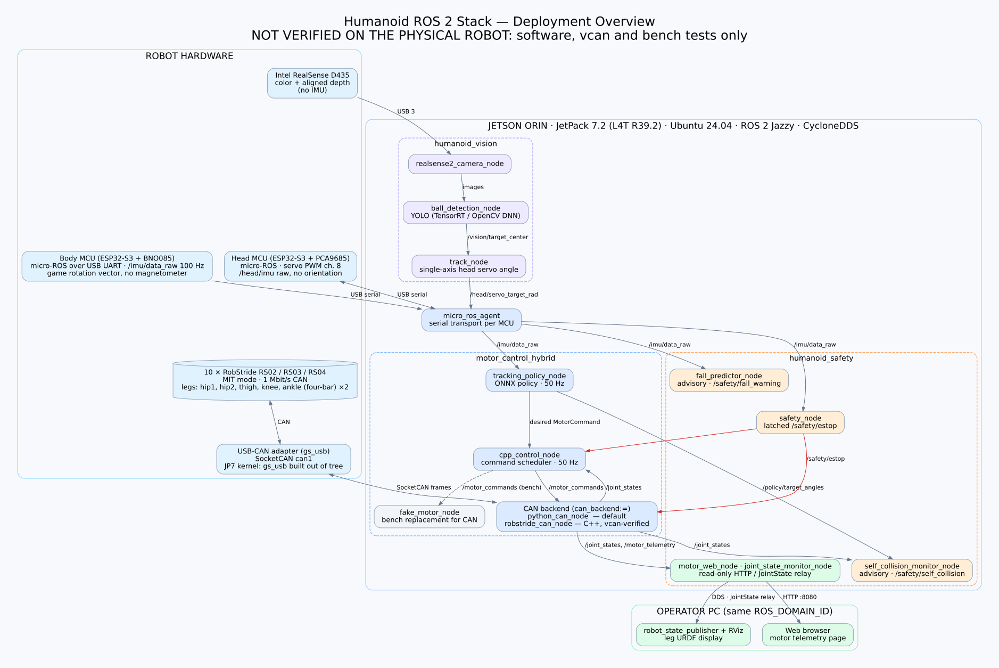
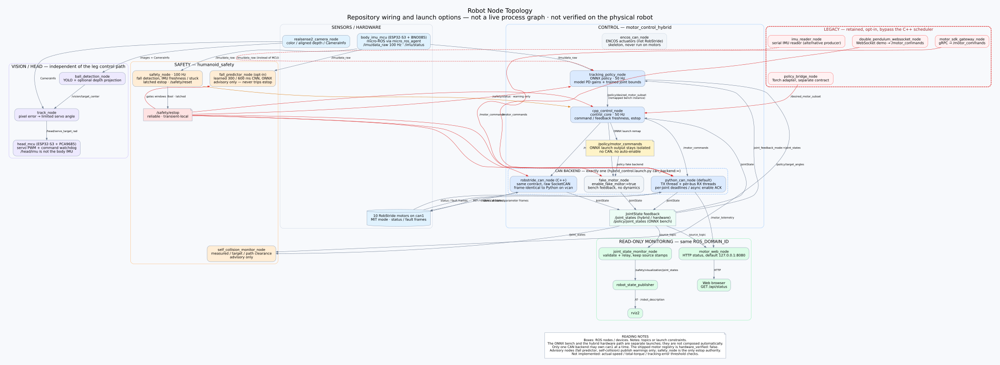
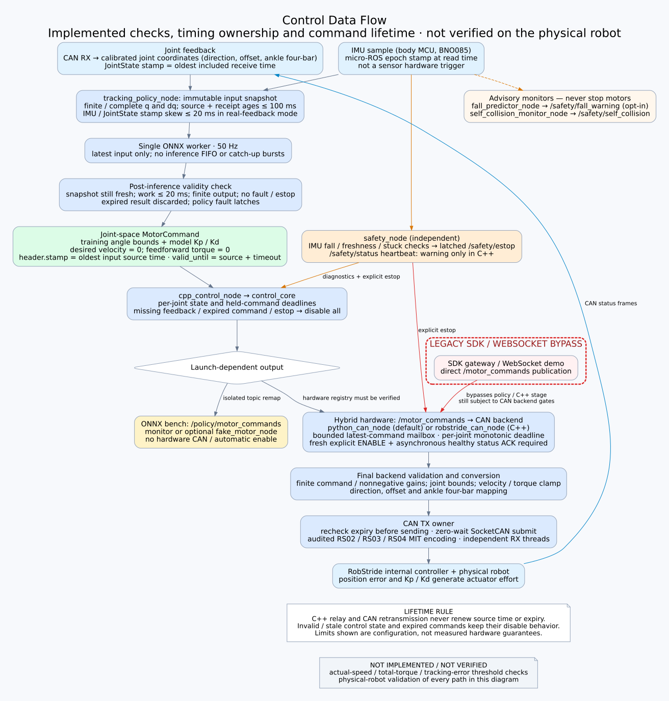

# Humanoid ROS 2 Control Stack

> [!WARNING]
> **UNTESTED ON THE PHYSICAL ROBOT.** Nothing in this repository has been
> validated on the assembled robot with motors powered.
> The shipped motor registry is deliberately
> `hardware_verified: false`, so real CAN startup is refused until motor IDs,
> zero, polarity, limits and stop behaviour are commissioned on hardware.
> Treat every launch that can reach motors as a first bring-up, with the robot
> supported and a physical power cut-off within reach.

ROS 2 workspace for a ten-joint humanoid leg: ONNX tracking-policy inference,
a C++ command scheduler, RobStride CAN backends (Python and C++), a latched
IMU safety supervisor with advisory fall prediction and self-collision
monitoring, read-only telemetry and visualization, and an independent visual
head-tracking path. Targets JetPack 7 (Ubuntu 24.04, ROS 2 Jazzy) on a Jetson
Orin; Humble / JetPack 6 still builds through the dev container.

The MuJoCo simulator and its sim-only tests live on the
[`humanoid_ros2_simulation`](https://github.com/triton-droids/embedded/tree/humanoid_ros2_simulation)
and [`sim-experimental-cyclonedds`](https://github.com/triton-droids/embedded/tree/sim-experimental-cyclonedds)
branches; this branch is the hardware stack.

## Contents

- [Repository structure](#repository-structure)
- [Architecture](#architecture)
- [Features and how to test them](#features-and-how-to-test-them)
  - [Known test issues](#known-test-issues)
  - [Common setup for tests](#common-setup-for-tests)
  - [Per-feature tests](#per-feature-tests)
- [Setup and build](#setup-and-build)
- [Launch entry points](#launch-entry-points)
- [Nodes and ROS interfaces](#nodes-and-ros-interfaces)
- [Published targets and commands](#published-targets-and-commands)
- [Tracking model inputs and outputs](#tracking-model-inputs-and-outputs)
- [MotorCommand contract](#motorcommand-contract)
- [Published feedback and diagnostics](#published-feedback-and-diagnostics)
- [Detailed guides](#detailed-guides)
- [Legacy](#legacy)

## Repository structure

| Path | Purpose |
|---|---|
| [`humanoid_control/motor_control_interfaces`](humanoid_control/motor_control_interfaces) | `MotorCommand`, `MotorFeedback` and abstract-command messages/services shared by every node. |
| [`humanoid_control/motor_control_hybrid`](humanoid_control/motor_control_hybrid) | ONNX tracking policy, C++ command scheduler (`cpp_control_node`), RobStride CAN backends (`python_can_node`, C++ `robstride_can_node`), ENCOS skeleton backend, fake motors, motor registry and deployed model. |
| [`Interfaces/control_core`](Interfaces/control_core) | ROS-independent per-joint command selection and hold-last storage used by the scheduler. |
| [`humanoid_control/humanoid_safety`](humanoid_control/humanoid_safety) | Latched safety supervisor, advisory fall predictor and self-collision monitor, read-only Web / JointState monitoring. |
| [`humanoid_vision`](humanoid_vision) | YOLO detection, optional depth projection, image viewer and single-axis head tracking. |
| [`imu_process`](imu_process) | Body IMU (ESP32-S3 + BNO085) and head MCU micro-ROS firmware, acceptance probe, retained serial IMU package and fusion utilities. |
| [`humanoid_leg_description`](humanoid_leg_description), [`humanoid_arm_description`](humanoid_arm_description) | URDFs, meshes and display launch files. |
| [`launch`](launch) | Workspace-level unified system, head-tracking and display entry points. |
| [`scripts`](scripts) | Environment setup (`setup_rosenv.sh`, `activate_rosenv.sh`), OpenCV SDK extraction, vcan wire check, tracking-policy build helper. |
| [`docs`](docs) | Architecture diagrams (Graphviz sources), protocol audits, watchdog and policy contracts. |
| [`legacy`](legacy) | Retained arm/leg MoveIt packages and the application SDK prototype. |

```text
humanoid_control/
  motor_control_hybrid/
    motor_control_hybrid/      Python nodes: tracking_policy_node, python_can_node, fake_motor_node, ...
    src/                       C++ nodes: cpp_control_node, robstride_can_node, encos_can_node
    include/motor_control_hybrid/  robstride_codec.hpp, robstride_registry.hpp (C++ CAN codec)
    config/motors.yaml         ten-joint RobStride registry (hardware_verified: false)
    models/20260914_170827/    deployed ONNX tracking policy + model XML
    launch/                    hybrid_control, control_test, tracking_policy, joint_state_monitor
    test/                      pytest, gtest, vcan differential test
  humanoid_safety/
    humanoid_safety/           safety_node, fall_predictor/, self_collision/, motor_web_node, relay
    models/fall_predictor/     dual-horizon fall CNN (ONNX) + thresholds
    launch/                    safety, self_collision, self_collision_rviz
```

## Architecture

The diagrams show repository wiring and launch options, not a measured live
process graph. Sources are Graphviz files; regenerate with
`dot -Tsvg docs/architecture/<name>.dot -o docs/architecture/<name>.svg`
(and `-Tpng` for the PNG copies).

### Deployment overview



[Open SVG](docs/architecture/system_overview.svg) ·
[Graphviz source](docs/architecture/system_overview.dot) ·
also exported as [`system.struct.png`](system.struct.png)

### Node topology



[Open SVG](docs/architecture/node_topology.svg) ·
[Graphviz source](docs/architecture/node_topology.dot)

### Control data flow



[Open SVG](docs/architecture/control_data_flow.svg) ·
[Graphviz source](docs/architecture/control_data_flow.dot)

The tracking-policy launch does not start CAN or send enable commands. The
hybrid launch starts the scheduler, safety and a CAN (or fake) backend but not
the policy. Composing policy and hardware is a deliberate, manual step.

## Features and how to test them

### Known test issues

- `test_control_stack_integration.py` fails: it expects the zero abstract
  command to be rejected in fake-motor mode, but `control_test.launch.py`
  enables simulation zero for fake motors, so it is accepted.
- `test_motor_monitor.py::test_config_hot_reload_keeps_all_motors_and_clears_changed_identity`
  fails intermittently.

### Common setup for tests

Run from the repository root after [building](#setup-and-build):

```bash
source scripts/activate_rosenv.sh          # ROS + rosenv + install + CycloneDDS (local profile)
export PYTEST_DISABLE_PLUGIN_AUTOLOAD=1    # required, see below
```

The local DDS profile keeps every test on loopback (see
[DDS middleware](#dds-middleware-cyclonedds)).

`PYTEST_DISABLE_PLUGIN_AUTOLOAD=1` matters: with the ROS pytest plugins
auto-loaded (ament lint / launch_testing, installed with ROS Jazzy), the
self-collision tests under `humanoid_safety/test/self_collision` are silently
not collected — pytest reports one skip and no failure.

Use a private `ROS_DOMAIN_ID` (non-zero) for every ROS integration test so it
cannot reach a running robot. CAN tests use a virtual interface only and refuse
physical CAN:

```bash
sudo modprobe vcan
sudo ip link add vcan0 type vcan && sudo ip link set vcan0 up
```

### Per-feature tests

#### 1. Environment and build

```bash
ROS_DISTRO=jazzy source scripts/setup_rosenv.sh
bash scripts/setup_opencv45.sh             # .deps/opencv46 on 24.04, .deps/opencv45 on 22.04
colcon build --symlink-install --cmake-args -DBUILD_TESTING=ON
```

Pass: every package builds; `install/` contains `python_can_node`,
`robstride_can_node`, `cpp_control_node`, `fall_predictor_node`, `track_node`.

#### 2. ONNX tracking policy

```bash
PYTHONPATH=humanoid_control/motor_control_hybrid:$PYTHONPATH python -m pytest -q \
  humanoid_control/motor_control_hybrid/test/test_tracking_onnx.py \
  humanoid_control/motor_control_hybrid/test/test_tracking_node.py \
  humanoid_control/motor_control_hybrid/test/test_inference_deadlines.py \
  humanoid_control/motor_control_hybrid/test/test_model_control_settings.py
```

Bench (no CAN, fake feedback, needs an IMU on `/imu/data_raw`):

```bash
ros2 launch motor_control_hybrid tracking_policy.launch.py start_imu_reader:=false \
  orientation_source:=message use_fake_joint_states:=true \
  joint_feedback_mode:=joint_states run_cpp_control:=true
ros2 topic hz /policy/desired_motor_subset    # expect ~50 Hz
ros2 topic echo /policy/status --once
```

#### 3. C++ command scheduler and control_core

```bash
build/motor_control_hybrid/cpp_state_watchdog_test
build/motor_control_hybrid/core_operation_test
ROS_DOMAIN_ID=181 python humanoid_control/motor_control_hybrid/test/ros_deadline_relay_smoke.py
ROS_DOMAIN_ID=182 RUN_ROS_INTEGRATION=1 PYTHONPATH=humanoid_control/motor_control_hybrid:$PYTHONPATH \
  python -m pytest -q humanoid_control/motor_control_hybrid/test/test_pose_monitor_integration.py \
  humanoid_control/motor_control_hybrid/test/test_control_stack_integration.py   # second file: known failure
```

#### 4. RobStride CAN backends (Python and C++)

```bash
PYTHONPATH=humanoid_control/motor_control_hybrid:$PYTHONPATH python -m pytest -q \
  humanoid_control/motor_control_hybrid/test/test_control_watchdogs.py \
  humanoid_control/motor_control_hybrid/test/test_can_transport.py \
  humanoid_control/motor_control_hybrid/test/test_motor_services.py \
  humanoid_control/motor_control_hybrid/test/test_motor_configuration.py
build/motor_control_hybrid/robstride_codec_test          # C++ frames vs Python vectors, bit for bit
python scripts/check_can_wire.py --channel vcan0         # SocketCAN encode/decode vs independent vectors
ROS_DOMAIN_ID=183 python humanoid_control/motor_control_hybrid/test/can_backend_diff.py \
  --registry humanoid_control/motor_control_hybrid/config/motors.yaml --channel vcan0
```

The differential test runs each backend against a fake RobStride responder on
vcan through disable, enable, MIT motion, position, velocity, watchdog timeout,
re-enable and estop, then compares the frames per motor. Regenerate the codec
vectors after changing `can_transport.py`, `motor_configuration.py` or
`ankle_mapping.py`:
`PYTHONPATH=humanoid_control/motor_control_hybrid python3 humanoid_control/motor_control_hybrid/test/gen_robstride_vectors.py`.

On JetPack 7 the USB-CAN adapter needs the `gs_usb` kernel module, which the
stock kernel does not build: compile it out of tree against the installed
headers (`/lib/modules/$(uname -r)/build`) from the matching kernel.org source,
and rebuild it after every `nvidia-l4t-kernel` update.

#### 5. Fake motors

```bash
PYTHONPATH=humanoid_control/motor_control_hybrid:$PYTHONPATH python -m pytest -q \
  humanoid_control/motor_control_hybrid/test/test_fake_operations.py
ros2 launch motor_control_hybrid hybrid_control.launch.py enable_fake_motor:=true \
  enable_sdk_gateway:=false enable_websocket_ui:=false enable_policy_bridge:=false
```

#### 6. Safety supervisor

```bash
python -m pytest -q humanoid_control/humanoid_safety/test \
  --ignore=humanoid_control/humanoid_safety/test/test_motor_monitor_integration.py
ROS_DOMAIN_ID=184 RUN_ROS_INTEGRATION=1 python -m pytest -q \
  humanoid_control/humanoid_safety/test/test_imu_time_contract.py \
  humanoid_control/humanoid_safety/test/test_motor_monitor_integration.py
```

Live check: `ros2 launch humanoid_safety safety.launch.py mode:=supervisor`,
then `ros2 topic echo /safety/estop` — it latches `true` when the body IMU stops
or reports a fall; `ros2 service call /safety/reset std_srvs/srv/Trigger` clears
it only when every check is healthy, and never enables motors.

#### 7. Fall predictor (advisory)

```bash
python -m pytest -q humanoid_control/humanoid_safety/test/test_fall_predictor.py
ros2 launch humanoid_safety safety.launch.py fall_predictor:=true \
  fall_predictor_log:=/tmp/fall_shadow.jsonl
ros2 topic echo /safety/fall_warning
```

It reads `/imu/data_raw` and `/safety/estop` only and never publishes the
estop. The model was trained in MuJoCo on the old RL tracking path; run it in
shadow (log only) on the robot before anything reacts to its warning.

#### 8. Self-collision monitor (advisory)

```bash
python -m pytest -q humanoid_control/humanoid_safety/test/self_collision
ros2 launch humanoid_safety self_collision.launch.py
ros2 topic echo /safety/self_collision --once
```

#### 9. Read-only monitoring (Web, relay, RViz)

```bash
ros2 launch humanoid_safety safety.launch.py mode:=monitor source_topic:=/joint_states
curl http://127.0.0.1:8080/api/status
```

#### 10. Body IMU firmware

```bash
g++ -std=c++17 -Wall -Wextra -Werror \
  imu_process/policy_imu/policy_imu_microros/test/body_imu_math_test.cpp -o /tmp/body-imu-math-test
/tmp/body-imu-math-test
# With the MCU flashed and the micro-ROS Agent running:
python3 imu_process/policy_imu/policy_imu_microros/check_body_imu.py
```

#### 11. Head tracking and vision

```bash
/usr/bin/python3 humanoid_vision/algorithm/test/test_track_node.py
(cd build/humanoid_vision && ctest --output-on-failure -R yolo_face_cpu)
```

Live: `ros2 launch launch/head_tracking.launch.py` (camera, detector, tracker,
micro-ROS Agent); see [TRACKING.md](humanoid_vision/TRACKING.md).

## Setup and build

Use the ROS distribution that matches the host OS. JetPack 7 / Ubuntu 24.04 uses
Jazzy and Python 3.12; on other distributions use the Humble
[dev container](docs/devcontainer.md). Recreate `rosenv/` on each host.

```bash
sudo apt install ros-jazzy-desktop ros-jazzy-rmw-cyclonedds-cpp ros-dev-tools \
  libyaml-cpp-dev libspdlog-dev libfmt-dev libzstd-dev libcap-dev
rosdep install --from-paths . --ignore-src -r -y --rosdistro jazzy
ROS_DISTRO=jazzy source scripts/setup_rosenv.sh   # control, ONNX, test dependencies
bash scripts/setup_opencv45.sh                     # vision: Ubuntu OpenCV SDK into .deps/
colcon build --symlink-install
source scripts/activate_rosenv.sh                  # every new terminal
```

`setup_rosenv.sh` installs [`requirements-rosenv.txt`](requirements-rosenv.txt)
into `rosenv/`, checks the Python version against the host ROS interpreter and
refreshes when a requirements file changes (`ROSENV_FORCE_INSTALL=1` forces it).
The ONNX policy does not need PyTorch; `INSTALL_TORCH=1` adds CPU PyTorch for the
legacy Torch bridge. If `setuptools` is missing from `rosenv` on Python 3.12,
install `setuptools==68.1.2` (newer releases break `--symlink-install` for
ament_python packages).

The vision package builds against the Ubuntu OpenCV SDK that
`setup_opencv45.sh` extracts (4.5.4 on 22.04, 4.6.0 on 24.04) so it matches
`cv_bridge`, not JetPack's OpenCV 4.8 development package. TensorRT/CUDA and
librealsense are optional build features. For tracking without the detector,
build `humanoid_vision` with `--cmake-args -DTRACK_ONLY=ON`.

`motor_control_hybrid` also builds `encos_can_node`: CMake uses an installed
`encos_driver >= 4.0` or downloads the pinned revision
`5ae8c3a92f6387369b674bfe7563bc053a460075`. Use
`-DMOTOR_CONTROL_FETCH_ENCOS=OFF` to forbid the download or
`-DMOTOR_CONTROL_BUILD_ENCOS=OFF` to skip it; offline builds can point
`-DFETCHCONTENT_SOURCE_DIR_ENCOS_DRIVER=/path/to/encos_driver` at a checkout.

### DDS middleware (CycloneDDS)

The workspace runs on CycloneDDS (`rmw_cyclonedds_cpp`), not the Jazzy default
Fast DDS. `source scripts/activate_rosenv.sh` selects it through
[`scripts/dds_env.sh`](scripts/dds_env.sh); every process of one ROS graph must
use the same profile, so start every robot process from an activated shell.

| `DDS_PROFILE` | Config | Use |
|---|---|---|
| `local` (default) | [`cyclonedds_local.xml`](config/dds/cyclonedds_local.xml) + [`fastdds_localhost.xml`](config/dds/fastdds_localhost.xml) | Everything on the robot. Loopback only, unicast discovery: the control path never depends on Wi-Fi, VPN or container bridges. |
| `lan` | [`cyclonedds_lan.xml`](config/dds/cyclonedds_lan.xml) | Robot and an operator PC (RViz, `ros2` CLI). Multicast discovery on `DDS_INTERFACE` (default: the default-route interface; pin it, e.g. `DDS_INTERFACE=wlP1p1s0`, when a VPN owns the default route). `DDS_PEER_IP=<other host>` adds a unicast peer where multicast is blocked. |
| `none` | — | Leave `RMW_IMPLEMENTATION` / `CYCLONEDDS_URI` untouched. |

```bash
source scripts/activate_rosenv.sh                       # local profile
DDS_PROFILE=lan source scripts/activate_rosenv.sh       # robot and operator PC, same ROS_DOMAIN_ID
```

The micro-ROS Agents (body IMU, head MCU) embed **Fast DDS** whatever
`RMW_IMPLEMENTATION` says. Default Fast DDS discovers by multicast and
advertises only external addresses, so it never meets the loopback-only
CycloneDDS graph. The local profile therefore also exports
`FASTRTPS_DEFAULT_PROFILES_FILE` pointing at a loopback-only Fast DDS profile,
which Fast DDS loads at start-up: start the Agent from an activated shell
(`head_tracking.launch.py agent_mode:=docker` passes the profile into the
container). With `lan`, both sides use plain multicast discovery and the Fast
DDS profile is not set.

After changing `DDS_PROFILE` or `RMW_IMPLEMENTATION`, run `ros2 daemon stop`: a
daemon started under other settings keeps answering `ros2 node list` /
`ros2 topic list` with an empty graph.

The CycloneDDS profiles still need validation with a real micro-ROS Agent and MCU.

The profiles request a 16 MB socket receive buffer, capped by the kernel limit:

```bash
echo 'net.core.rmem_max=33554432' | sudo tee /etc/sysctl.d/60-cyclonedds.conf
sudo sysctl -p /etc/sysctl.d/60-cyclonedds.conf
```

## Launch entry points

Run from the repository root after `source scripts/activate_rosenv.sh`.
Processes on different hosts must share `ROS_DOMAIN_ID` and use
`DDS_PROFILE=lan` (see [DDS middleware](#dds-middleware-cyclonedds)).

| Task | Command | Behaviour |
|---|---|---|
| Body control, safety, Web and RViz | `ros2 launch motor_control_hybrid control_test.launch.py` | Real CAN, C++ core, safety supervisor, WebUI, joint relay, model TF and RViz. No startup enable / home / zero. `enable_fake_motor:=true` replaces CAN; `use_rviz:=false` for headless. |
| Control stack, fake motors | `ros2 launch motor_control_hybrid hybrid_control.launch.py enable_fake_motor:=true enable_sdk_gateway:=false enable_websocket_ui:=false enable_policy_bridge:=false` | Fake motors, C++ scheduler and safety. No automatic enable; without a body IMU, safety latches after its startup grace. |
| Control stack, real CAN (Python backend) | `ros2 launch motor_control_hybrid hybrid_control.launch.py` | `python_can_node` on the registry's interfaces. Refused while the registry is `hardware_verified: false`. |
| Control stack, real CAN (C++ backend) | `ros2 launch motor_control_hybrid hybrid_control.launch.py can_backend:=cpp` | `robstride_can_node` instead of `python_can_node`; same topics, services and parameters. vcan-verified only. |
| ONNX policy | `ros2 launch motor_control_hybrid tracking_policy.launch.py` | External IMU, zero joint feedback by default, `/policy/*` outputs. No CAN, safety or enable. |
| Policy bench | `ros2 launch motor_control_hybrid tracking_policy.launch.py use_fake_joint_states:=true run_cpp_control:=true joint_feedback_mode:=joint_states` | Adds fake feedback and the remapped scheduler. Fake motors stay disabled until explicitly enabled. |
| Safety supervisor | `ros2 launch humanoid_safety safety.launch.py mode:=supervisor` | IMU checks, latched estop, diagnostics and reset service. |
| Safety + fall predictor | `ros2 launch humanoid_safety safety.launch.py fall_predictor:=true` | Adds the advisory `fall_predictor_node` (`fall_predictor_log:=` for a shadow log). |
| Read-only monitoring | `ros2 launch humanoid_safety safety.launch.py mode:=monitor` | HTTP telemetry and JointState relay/display; no supervisor. |
| Self-collision monitor | `ros2 launch humanoid_safety self_collision.launch.py` | Advisory geometry checker (Pinocchio backend). |
| Head tracking | `ros2 launch launch/head_tracking.launch.py` | Camera, detector, tracker and serial micro-ROS Agent. `enable_depth:=true` for 3D output. |
| Leg display | `ros2 launch launch/display.launch.py use_joint_state_gui:=false` | Displays the selected joint-state stream. |
| Unified system | `ros2 launch launch/system.launch.py` | Real CAN, C++ scheduler, safety, head tracking, leg state publisher and RViz. No policy. |

The unified launch requests SCHED_RR priorities 20 (CAN TX), 21 (CAN RX) and 10
(C++ executor); `enable_rt:=false` disables them and permission failures only
warn. Inspect switches with `ros2 launch <package> <file> --show-args`.

## Nodes and ROS interfaces

Standard ROS logging, parameter services and `/parameter_events` are omitted.
CAN, fake-motor, SDK and WebSocket nodes use relative motor topic names, so a
namespace changes them. Abbreviations: `MotorCommand` =
`motor_control_interfaces/msg/MotorCommand`, `JointState` =
`sensor_msgs/msg/JointState`, `Imu` = `sensor_msgs/msg/Imu`, `PointStamped` =
`geometry_msgs/msg/PointStamped`, `DiagnosticArray` =
`diagnostic_msgs/msg/DiagnosticArray`.

### Control and policy nodes

| Node | Responsibility | Publishes | Subscribes |
|---|---|---|---|
| [`tracking_policy_node`](humanoid_control/motor_control_hybrid/motor_control_hybrid/tracking_policy_node.py) | Ten-joint ONNX policy at 50 Hz; gyro calibration, input freshness / skew, inference deadlines, estop. | `/policy/actions`, `/policy/target_angles`, `/policy/desired_motor_subset`, `/policy/status` | IMU and joint-state inputs; `/safety/estop` |
| [`cpp_control_node`](humanoid_control/motor_control_hybrid/src/cpp_control_node.cpp) | Schedules per-joint commands at 50 Hz; deadlines / estop; default-disabled zero state machine. | `/motor_commands`, `/control_core/abstract_command_status` | `/joint_states`, `/desired_motor_subset`, `/desired_velocity_subset`, `/control_core/abstract_command`, `/safety/estop`, `/safety/status` |
| [`python_can_node`](humanoid_control/motor_control_hybrid/motor_control_hybrid/python_can_node.py) | Default RobStride backend: independent TX and per-bus RX threads, command checks, enable ACK, local deadlines, feedback. | `/joint_states`, `/motor_status`, `/motor_telemetry`, `/can_timing` | `/motor_commands`, `/safety/estop` |
| [`robstride_can_node`](humanoid_control/motor_control_hybrid/src/robstride_can_node.cpp) | C++ RobStride backend (`can_backend:=cpp`), same contract on raw SocketCAN; codec in [`robstride_codec.hpp`](humanoid_control/motor_control_hybrid/include/motor_control_hybrid/robstride_codec.hpp). | same as `python_can_node` | same as `python_can_node` |
| [`encos_can_node`](humanoid_control/motor_control_hybrid/src/encos_can_node.cpp) | Skeleton backend for ENCOS actuators with the same contract; never run on motors. | same topic contract | same topic contract |
| [`fake_motor_node`](humanoid_control/motor_control_hybrid/motor_control_hybrid/fake_motor_node.py) | Simple simulated joint motion and status without CAN; not a dynamics model. | `/joint_states`, `/motor_status` | `/motor_commands`, `/safety/estop` |

The CAN backends also serve `motor_backend/get_feedback`
(`GetMotorFeedback`, cached raw motor-coordinate feedback) and
`motor_backend/execute_operation` (`ExecuteMotorOperation`); Set Zero is
currently always rejected and no service sends a calibration frame. The C++
scheduler also serves `/control_core/submit_abstract_command`; zero processing
is disabled by default. See the
[backend service contract](docs/robstride_abstract_command_design.md#initial-backend-services).

The policy's default `joint_feedback_mode:=zero` supplies zero joint feedback;
`joint_states` requires real JointState input (`/policy/joint_states` in the
tracking launch). The scheduler forwards gains and targets; it does not run
inference or compute PD torque. Missing / stale feedback from any configured
joint, an expired command or an asserted estop disables all joints and clears
cached commands (default feedback / command timeouts 0.2 s / 0.5 s). A missing
`/safety/status` heartbeat only warns.

### Safety and monitoring nodes

| Node | Responsibility | Publishes | Subscribes |
|---|---|---|---|
| [`safety_node`](humanoid_control/humanoid_safety/humanoid_safety/safety_node.py) | IMU orientation, freshness and stuck checks on a steady-clock timer; latches estop; `/safety/reset` (`std_srvs/srv/Trigger`). The only estop authority. | `/safety/estop`, `/safety/status` | `/imu/data_raw` |
| [`fall_predictor_node`](humanoid_control/humanoid_safety/humanoid_safety/fall_predictor/node.py) | Advisory learned fall predictor (300 / 600 ms heads, ONNX); never publishes the estop. | `/safety/fall_warning`, `/safety/fall_prediction` | `/imu/data_raw`, `/safety/estop` |
| [`self_collision_monitor_node`](humanoid_control/humanoid_safety/humanoid_safety/self_collision/monitor_node.py) | Measured, target and sampled-path clearance at 20 Hz; advisory only. | `/safety/self_collision`, optional `/safety/self_collision/markers` | `/joint_states`, `/policy/target_angles` |
| [`motor_web_node`](humanoid_control/humanoid_safety/humanoid_safety/motor_web_node.py) | Read-only HTTP telemetry, default `127.0.0.1:8080`. | none | `/joint_states`, `/motor_telemetry`, `/safety/estop`, `/safety/status` |
| [`joint_state_monitor_node`](humanoid_control/humanoid_safety/humanoid_safety/joint_state_monitor_node.py) | Validates and relays JointState, preserving source stamps. | configurable `output_topic` | configurable `source_topic` |

### Vision, IMU and MCU nodes

| Node | Responsibility | Publishes | Subscribes |
|---|---|---|---|
| [`ball_detection_node`](humanoid_vision/src/ball_detection_node.cpp) | YOLO; highest-confidence detection center plus optional depth 3D point. The bundled model detects faces. | `/vision/target_center`, `/vision/ball_3d_position` | color, aligned depth and CameraInfo under `/camera/camera/` |
| [`track_node`](humanoid_vision/src/track_node.cpp) | Pixel error → single yaw or pitch angle with deadband, rate / angle limits and freshness checks. | `/head/servo_target_rad` | `/vision/target_center`, CameraInfo |
| [`image_viewer_node`](humanoid_vision/src/image_viewer_node.cpp) | Displays color / depth images for diagnostics. | none | configurable image topics |
| [`body_imu_mcu`](imu_process/policy_imu/policy_imu_microros/policy_imu_microros.ino) | ESP32-S3 + BNO085 micro-ROS firmware; IMU at 100 Hz, status at 1 Hz. | `/imu/data_raw`, `/imu/status` | none |
| [`head_mcu`](imu_process/head_mcu/humanoid_vision_microros/humanoid_vision_microros.ino) | ESP32-S3 head firmware; raw IMU and PCA9685 channel-8 servo PWM with command timeout. | `/head/imu`, `/head/mcu_status` | `/head/servo_target_rad` |
| [`body_imu_probe`](imu_process/policy_imu/policy_imu_microros/check_body_imu.py) | Read-only acceptance check for IMU timing, units and orientation. | none | `/imu/data_raw`, `/imu/status` |

External nodes used by active launches: `realsense2_camera_node`,
`micro_ros_agent`, `robot_state_publisher`, `joint_state_publisher_gui` and
`rviz2`.

## Published targets and commands

| Topic and type | Producer → consumer | Meaning |
|---|---|---|
| `/policy/actions` — `std_msgs/msg/Float64MultiArray` | ONNX policy → logging | Ten raw policy actions in model joint order; not angles. |
| `/policy/target_angles` — `JointState` | ONNX policy → collision monitor, visualization | Decoded, limited joint-position targets (rad); commands, not feedback. |
| `/policy/desired_motor_subset` — `MotorCommand` | ONNX policy → remapped scheduler | MIT target envelope with model gains, source stamp and expiry; isolated from hardware by default. |
| `/desired_motor_subset` — `MotorCommand` | upstream controller → scheduler | The scheduler's normal input. |
| `/desired_velocity_subset` — `JointState` | external producer → scheduler | Per-joint velocity requests (compatibility input). |
| `/motor_commands` — `MotorCommand` | scheduler or direct adapter → CAN / fake backend | Commands actually submitted, including enable / disable. |
| `/policy/motor_commands` — `MotorCommand` | remapped scheduler → namespaced fake backend | Bench counterpart; never routed to real CAN by the tracking launch. |
| `/vision/target_center` — `PointStamped` | detector → head tracker | Pixel center (`x=u`, `y=v`, `z=0`) with the image header. |
| `/vision/ball_3d_position` — `PointStamped` | detector → external | Optional camera-frame point (m); unsynchronized depth. |
| `/head/servo_target_rad` — `std_msgs/msg/Float32` | head tracker → head MCU | Absolute servo angle command (rad). |

## Tracking model inputs and outputs

The deployed export is
[`20260914_170827.onnx`](humanoid_control/motor_control_hybrid/models/20260914_170827/20260914_170827.onnx):
56 observation values, ten actions, 50 Hz, CPU ONNX Runtime.

| ONNX input | Type and shape | Meaning |
|---|---|---|
| `obs` | `float32 [1, 56]` | One observation in the order below. |
| `time_step` | `float32 [1, 1]` | Integer reference-frame index, not seconds. |

| Slice of `obs[0]` | Size | Content |
|---|---:|---|
| `[0:10]` | 10 | Reference joint angles (rad). |
| `[10:20]` | 10 | Reference joint velocities (rad/s). |
| `[20:23]` | 3 | Body angular velocity after mounting rotation and gyro bias (rad/s). |
| `[23:33]` | 10 | Joint positions minus `q_default` (rad). |
| `[33:43]` | 10 | Joint velocities (rad/s). |
| `[43:53]` | 10 | Previous raw actions. |
| `[53:56]` | 3 | Unit gravity in body frame; upright is `[0, 0, -1]`. |

Joint order for every ten-joint vector:

```text
left_hip1_joint, left_hip2_joint, left_thigh_joint, left_knee_joint,
left_ankle_joint, right_hip1_joint, right_hip2_joint, right_thigh_joint,
right_knee_joint, right_ankle_joint
```

The output `actions` (ten values) decodes as
`q_target = clip(q_default + action_scale * action, joint_lower, joint_upper)`
with `q_default = 0`, `action_scale = 0.2` and limits from the model XML. Target
velocity and feedforward torque are zero; gains come from the model metadata
(Kp 100 hip1 / hip2 / thigh, 80 knee, 20 ankle; Kd 1). The reference motion has
299 frames and holds the last one. See
[`tracking_policy_ros2.md`](docs/tracking_policy_ros2.md) for the runtime
parameters (`input_timeout_s`, `max_input_skew_s`, `max_inference_s`, IMU
mounting rotation, gyro calibration) and fault behaviour.

## MotorCommand contract

[`MotorCommand.msg`](humanoid_control/motor_control_interfaces/msg/MotorCommand.msg):
`joint_name[i]` names each entry; `mode` is broadcast (one value) or per joint:
velocity `0`, position `1`, MIT motion `2`, enable `3`, disable `4`. Positions in
rad, velocities in rad/s, feedforward torque in Nm at the joint interface.
`header.stamp` keeps the originating source time and `valid_until` an absolute
deadline; forwarding never renews a command's lifetime. Disable is admissible
even with an invalid stamp.

## Published feedback and diagnostics

| Topic and type | Producer | Purpose |
|---|---|---|
| `/joint_states` — `JointState` | CAN or fake backend | Joint position, velocity, effort (fake feedback is not measurement). |
| `/policy/joint_states` — `JointState` | namespaced fake backend / external | Policy-bench feedback. |
| `/safety/visualization/joint_states` — `JointState` | safety relay | Validated display stream. |
| `/motor_status`, `/motor_telemetry`, `/can_timing` — `std_msgs/msg/String` | CAN backend | Temperature / torque JSON, versioned telemetry JSON, TX/RX timing counters. |
| `/policy/status` — `std_msgs/msg/String` | ONNX policy | State, faults, rejection and timing. |
| `/imu/data_raw` — `Imu`, `/imu/status` | body MCU | Body IMU and its diagnostics. |
| `/head/imu`, `/head/mcu_status` | head MCU | Raw head IMU (no orientation) and status flags. |
| `/safety/estop` — `std_msgs/msg/Bool` | safety supervisor | Reliable, transient-local estop; reset never enables motors. |
| `/safety/status` — `DiagnosticArray` | safety supervisor | Check health, latch state and reason. |
| `/safety/fall_warning` — `std_msgs/msg/Bool` | fall predictor | Latched advisory warning (600 ms head by default). |
| `/safety/fall_prediction` — `std_msgs/msg/String` | fall predictor | Per-sample scores, alarms and eligibility (JSON). |
| `/safety/self_collision` — `DiagnosticArray` | collision monitor | Advisory clearance / collision reports. |

## Detailed guides

- [Workspace launch options](launch/README.md)
- [ONNX observation, action and timing contract](docs/tracking_policy_ros2.md)
- [Policy and visualization workflow](docs/activate_tracking_system.md)
- [Control watchdogs](docs/control_watchdogs.md)
- [RobStride CAN protocol audit](docs/can_protocol_audit.md)
- [RobStride manual review and abstract-command design](docs/robstride_abstract_command_design.md)
- [Safety supervisor, fall predictor and monitoring](humanoid_control/humanoid_safety/README.md)
- [Self-collision monitoring](docs/self_collision_monitor.md)
- [Head tracking controls and tests](humanoid_vision/TRACKING.md)
- [Head MCU interface](imu_process/head_mcu/README.md)
- [Body IMU firmware and acceptance checks](imu_process/policy_imu/policy_imu_microros/README.md)
- [IMU source layout](imu_process/README.md)

## Legacy

Retained for reference and explicit opt-in use, outside the active
policy / CAN / head composition. ROS package names are unchanged and colcon
still discovers them.

| Path / node | Retained functionality |
|---|---|
| [`humanoid_leg_moveit_config`](legacy/humanoid_leg_moveit_config), [`humanoid_arm_moveit_config`](legacy/humanoid_arm_moveit_config) | MoveIt planning and ros2_control demos (`ros2 launch <pkg> demo.launch.py`). |
| [`sdk_prototype`](legacy/sdk_prototype) | Application SDK, gRPC client, browser tools and examples. |
| [`Attitude_Sensing`](<imu_process/Attitude_Sensing(Depreciated)>) / `imu_reader_node` | Serial IMU reader; alternative `/imu/data_raw` producer (use one producer, not both). |
| [`policy_bridge_node`](humanoid_control/motor_control_hybrid/motor_control_hybrid/policy_bridge_node.py) | Torch adapter with a separate model contract, publishing `/desired_motor_subset`. |
| [`motor_sdk_gateway_node`](humanoid_control/motor_control_hybrid/motor_control_hybrid/motor_sdk_gateway_node.py) | gRPC command / status gateway, default `127.0.0.1:50052`. |
| [`double_pendulum_websocket_node`](humanoid_control/motor_control_hybrid/motor_control_hybrid/double_pendulum_websocket_node.py) | Browser WebSocket demo bridge (hybrid launch: `0.0.0.0:8765`). |

The SDK and WebSocket bridges publish `/motor_commands` directly, bypassing the
C++ scheduler; CAN-backend checks and the estop still apply.
