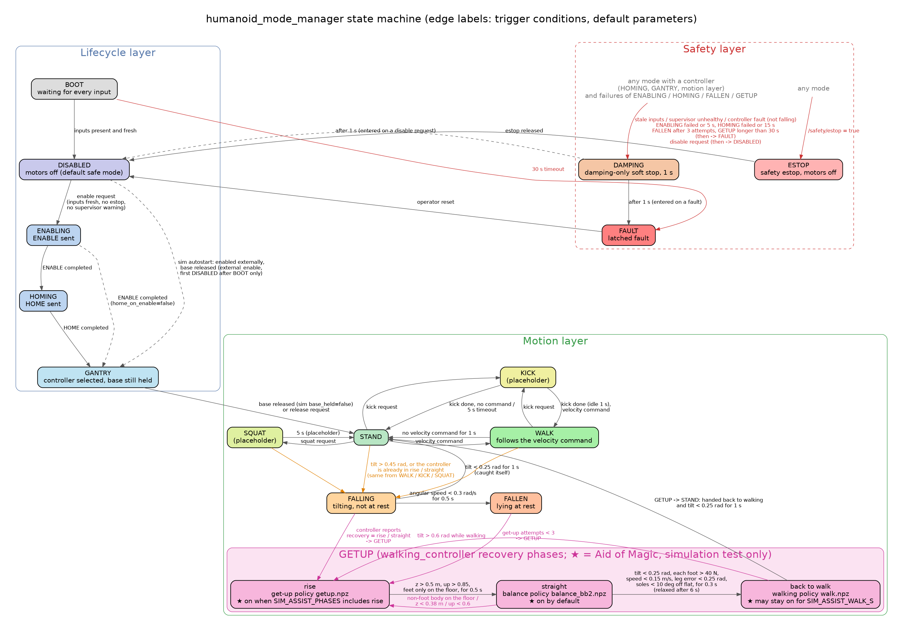

# humanoid_mode_manager

**Status: placeholder.** The state machine and its ROS wrapper exist and are unit tested, but the node runs
in `dry_run` by default: it computes and publishes the robot mode and logs the actions it would take, and
executes none of them. Several actions have no ROS interface yet (see [Missing interfaces](#missing-interfaces)).
Validated as a dry run in simulation only (see [docs/testing.md](docs/testing.md)); not run on hardware.

## Where things are

| Path | Contents |
|---|---|
| [`humanoid_mode_manager/core/`](humanoid_mode_manager/core) | The mode machine, no ROS: `states.py` (modes), `observation.py` (input snapshot, status parsers), `actions.py` (requested side effects), `machine.py` (transitions) |
| [`humanoid_mode_manager/ros/node.py`](humanoid_mode_manager/ros/node.py) | ROS 2 node: fills an `Observation` from the topics, executes the actions, publishes `/mode_manager/state` |
| [`config/mode_manager.yaml`](config/mode_manager.yaml) | Every parameter with its default |
| [`launch/mode_manager.launch.py`](launch/mode_manager.launch.py) | The node alone; in the sim use `sim.launch.py mode_manager:=true` |
| [`test/test_machine.py`](test/test_machine.py) | Unit tests of the machine |
| [`tools/`](tools) | `run_scenario.sh` (full-body scenario video), `record_scenario.py`, `render_scenario.py` |
| [`docs/state_machine.png`](docs/state_machine.png) | Diagram of every mode and get-up phase, edges labelled with their trigger conditions (source: `state_machine.dot`) |
| [`docs/states.md`](docs/states.md) | Entry condition of every mode, with the parameter behind each threshold |
| [`docs/testing.md`](docs/testing.md) | Unit tests, simulation dry-run results, how to make the scenario video |

One node decides which mode the robot is in and which controller owns the motors. It never sends motor
commands itself and never clears an estop: `humanoid_safety` stays independent, `cpp_control_node` keeps its
watchdogs and command deadlines.

```
task layer     ball_chase (velocity, kick requests)
mode manager   humanoid_mode_manager            <- this package
controllers    tracking_policy_node / walking_controller / (get-up)
arbitration    cpp_control_node (forwards one source)
safety         humanoid_safety (/safety/estop, highest priority)
```

## Modes



| Layer | Mode | Meaning |
|---|---|---|
| safety | `estop` | `/safety/estop` true (any mode). Leaves to `disabled` once humanoid_safety releases it (`reset` calls `/safety/reset`). |
| | `damping` | Soft stop (damping only) for `damping_s`, then `disabled` (requested) or `fault`. |
| | `fault` | Latched: stale inputs, supervisor at ERROR, controller fault, enable/home failure or timeout, get-up limit. `reset` returns to `disabled`. |
| lifecycle | `boot` | Waiting for joints, IMU, controller status and estop. |
| | `disabled` | Motors disabled. `enable` (only with fresh inputs, estop false and the supervisor not at WARN, as in cpp_control_node) starts the sequence. |
| | `enabling` / `homing` | ENABLE / HOME through `/control_core/submit_abstract_command`, waiting for COMPLETED. |
| | `gantry` | Controller selected, base held. Leaves on `/sim/status` `base_held: false` (`gantry: sim`) or a `release` request. |
| motion | `stand` / `walk` | Velocity command present (`walk`) or idle for `stand_after_s` (`stand`). Task velocity passes only here. |
| | `kick` | `kick_left` / `kick_right` -> `/walk/kick`; ends when `/walk/status` `kick` is idle. Walking controller only. |
| | `squat` | Placeholder: no runtime squat request exists; times out back to `stand`. |
| | `falling` | Tilt > `fall_tilt_rad`, the walking controller's own recovery started, or (optional) `/safety/fall_warning`. |
| | `fallen` | At rest after a fall. Asks for a localization reset. |
| | `getup` | `getup: walking_controller`: follows its internal rise/straight and ends on hand-over; `getup: policy`: switches to `getup_model`. At most `max_getup_attempts` in a row. |

Exact entry conditions and thresholds: [docs/states.md](docs/states.md).

`walk` also carries a navigation sub-mode from `/localization/status` (`navigate` / `local_only` / `hold`);
it is published only, nothing acts on it yet.

## Interfaces

| Direction | Name | Type |
|---|---|---|
| in | `/safety/estop` | `std_msgs/Bool` (latched) |
| in | `/safety/status` (`humanoid_safety/supervisor`) | `diagnostic_msgs/DiagnosticArray` |
| in | `/joint_states`, `/imu/data_raw` | `sensor_msgs/JointState`, `sensor_msgs/Imu` |
| in | `/walk/status` or `/policy/status` | `std_msgs/String` JSON |
| in | `/sim/status`, `/localization/status` | `std_msgs/String` JSON |
| in | `/safety/fall_warning` | `std_msgs/Bool` (humanoid_safety `fall_predictor_node`; `sim.launch.py fall_predictor:=true`) |
| in | `/ball_chase/cmd_vel` | `geometry_msgs/TwistStamped` |
| in | `/control_core/abstract_command_status` | `motor_control_interfaces/AbstractCommandStatus` |
| in | `/mode_manager/request` | `std_msgs/String`: `enable`, `disable`, `reset`, `release`, `kick_left`, `kick_right`, `squat` |
| service | `/mode_manager/{enable,disable,reset,release}` | `std_srvs/Trigger` |
| out | `/mode_manager/state` | `std_msgs/String` JSON (latched): mode, reason, history, actions |
| out | `/mode_manager/cmd_vel` | `geometry_msgs/TwistStamped` (with `gate_cmd_vel`; zero outside `stand`/`walk`) |
| out | `/walk/kick` | `std_msgs/String` |
| client | `/control_core/submit_abstract_command`, `/safety/reset`, `/policy/switch_model` | |

External enable: with `external_enable` (default: same as `dry_run`) another node enables the motors
(`sim_autostart`), and the first `disabled` follows the gantry release straight to `gantry` / `stand`.

## Run

```bash
ros2 launch humanoid_mode_manager mode_manager.launch.py controller:=walk
ros2 launch humanoid_sim sim.launch.py controller:=model_walk mode_manager:=true   # dry run in the sim
ros2 topic echo /mode_manager/state
ros2 service call /mode_manager/enable std_srvs/srv/Trigger
```

`mode_manager_dry_run:=false` lets it enable the motors itself, so `auto_start` must stay false.

## Missing interfaces

| Action | Needed |
|---|---|
| `SelectSource` | `cpp_control_node` subscribes one `/desired_motor_subset` chosen by a launch remap; it needs several sources and a select service. |
| `Damp` | A damping-only command path (kp 0, kd only) through `cpp_control_node`. |
| `ResetController` | `walking_controller` latches faults until restarted; needs a `/walk/reset` service. |
| `ResetLocalization` | `vio_localizer` has no reset; needs `/localization/reset`. |
| `SwitchModel` | `SwitchPolicyModel` is on `feat/policy-switching`; without it the action is logged only. |
| fall warning | The fall predictor (`/safety/fall_warning`) was trained on the legs model under the old RL tracking policy; on the full body its warning is untested. |

Status topics are slow (`/walk/status` 2 Hz, `/policy/status` 1 Hz), so controller faults are seen with up to
0.5-1 s delay; the motor path does not depend on this node.
