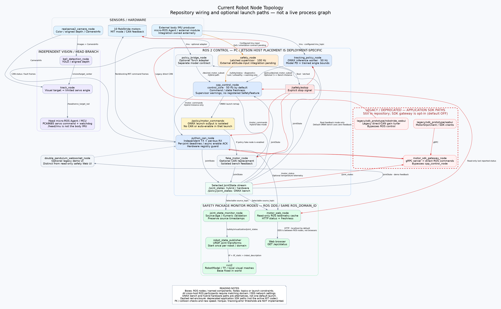
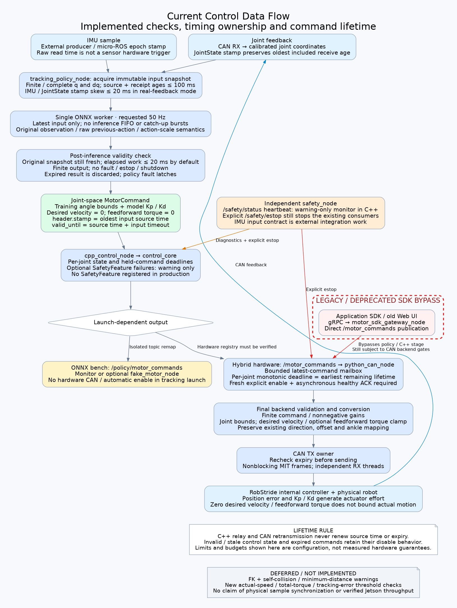

# Shared Control Architecture

This repository now targets simulation only. Physical backends and device launch
recipes shown in the retained diagrams are archived under `hardware/`; SDK/Torch
adapters are under `legacy/`. Those branches are not installed by the active
build. See [the simulation guide](../simulation/humanoid_sim/README.md) for the
supported composition.

These diagrams describe the current repository's node interfaces and launch
options. They are **not a live `ros2 node list` / `rqt_graph` capture**, and do
not mean all components are launched together or hardware-tested. No runtime
configuration or controller code was changed to produce them.

## 1. Node topology and ROS network

[Open scalable SVG](architecture/node_topology.svg) ·
[PNG](architecture/node_topology.png) ·
[Editable Graphviz source](architecture/node_topology.dot)



Blue identifies control nodes, green identifies read-only safety-package
monitoring, orange identifies the independent supervisor, and purple identifies
the independent vision/head branch. The **red dashed enclosure marks the legacy /
deprecated application SDK paths**. This label does not deprecate the low-level
MIT frame codec reused by the active CAN transport.

All ROS participants communicating across PC and Jetson must share the intended
`ROS_DOMAIN_ID` and compatible DDS network settings. The safety Web node obtains
robot telemetry through ROS; the browser obtains its UI/status through HTTP.
Placement of compute nodes on PC versus Jetson is a deployment choice, not a
fixed host assignment in the diagram.

## 2. Control data flow and timing ownership

[Open scalable SVG](architecture/control_data_flow.svg) ·
[PNG](architecture/control_data_flow.png) ·
[Editable Graphviz source](architecture/control_data_flow.dot)



The second diagram combines the ONNX policy stages, the common C++ scheduler,
and available backend paths. **The hardware branch requires explicit topic
remapping/composition; the current tracking launch does not connect ONNX outputs
to hardware by default.** The launch-dependent diamond describes alternative
launch configurations, not a runtime routing node.

## Launch paths that must remain distinct

| Path | Current behavior |
|---|---|
| `tracking_policy.launch.py` | ONNX at 50 Hz; external IMU; zero joint feedback by default; optional real-feedback selection, fake motors and C++ scheduler. Outputs remain under `/policy/*`. No CAN or automatic enable is launched. |
| `hybrid_control.launch.py` | C++ scheduler with real CAN or optional fake backend; optional Torch adapter; safety supervisor. Real CAN is blocked by the current unverified hardware registry. |
| `safety.launch.py mode:=web` | Read-only ROS telemetry to HTTP UI. |
| `safety.launch.py mode:=rviz` | Selected JointState relay, optional local robot-state publisher and RViz. |
| `safety.launch.py mode:=monitor` | Both read-only views; no supervisor started implicitly. |
| `safety.launch.py mode:=supervisor` | Existing safety supervisor; default safety-package mode. |
| `safety.launch.py mode:=all` | Supervisor and both views. |
| `head_tracking.launch.py` | Independent camera/detector/tracker/head-MCU branch. Head IMU is not substituted for the body IMU. |

The legacy SDK gateway is **opt-in** (`enable_sdk_gateway:=true`, default `false`);
only the double-pendulum demo is on by default in `hybrid_control.launch.py`.
Marking the SDK deprecated in these diagrams **does not remove those processes**,
and enabling the gateway still publishes
`/motor_commands` directly, bypassing the C++ scheduler; CAN-local validation and
expiry still apply. The old direct-CAN gain tuner bypasses the ROS control path.
The new safety Web UI is read-only and is separate from these legacy tools.

## Implemented versus deferred

Implemented: original ONNX action semantics and model PD/angle bounds, independent
inference worker, immutable snapshot checks, command lifetime preservation,
per-joint freshness/deadlines, independent CAN RX/TX, asynchronous enable reports,
explicit estop handling, advisory supervisor monitoring, and safety-package views.

Production currently registers **no `SafetyFeature`**. Failed/throwing future
features produce warnings and continue normal current command selection.
Supervisor heartbeat failures/unhealthy diagnostics are warning-only; explicit
estop and existing command/state timeout behavior remain separate.

Deferred: FK/self-collision/minimum-distance checking, new actual-speed/total-
torque/tracking-error thresholds, and ankle transmission analysis. External
IMU/attitude integration, physical sensor alignment, Jetson full-load timing,
network discovery and physical stopping behavior still require integration or
measurement. Diagram frequencies/budgets are settings, not measured guarantees.

## Source references

- `humanoid_control/motor_control_hybrid/launch/tracking_policy.launch.py`
- `hardware/motor_control_hybrid/launch/hybrid_control.launch.py`
- `humanoid_control/motor_control_hybrid/motor_control_hybrid/tracking_policy_node.py`
- `humanoid_control/motor_control_hybrid/src/cpp_control_node.cpp`
- `hardware/motor_control_hybrid/motor_control_hybrid/python_can_node.py`
- `humanoid_control/humanoid_safety/launch/safety.launch.py`
- `humanoid_control/humanoid_safety/humanoid_safety/`
- `humanoid_leg_description/launch/display.launch.py`
- `humanoid_vision/launch/head_tracking.launch.py`
- `legacy/sdk_prototype/webui/` and `legacy/sdk_prototype/robstride_webui/`

## Regenerate the figures

From the workspace root, with the existing Graphviz installation:

```bash
for figure in node_topology control_data_flow; do
  dot -Tsvg "docs/architecture/$figure.dot" -o "docs/architecture/$figure.svg"
  dot -Tpng -Gdpi=105 "docs/architecture/$figure.dot" -o "docs/architecture/$figure.png"
done
```
